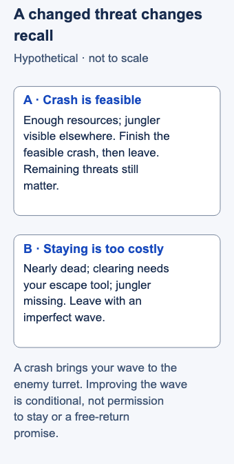

# Recalling

- Stable lesson ID: MA02
- Slug: recalling
- Category: Macro
- Roles and level: Top, Mid and Bot; beginner. Jungle and Support can use the recovery and destination checks without assuming responsibility for a lane wave.
- Summary: Return to base for recovery and purchases while weighing the cost of leaving.
- Prerequisites: Wave crashing, Resource management.
- Observable action: Before staying for another wave action, name the threat that could stop your recall.

## Short answer

Recalling is the action that returns your champion to base. Recall timing is the decision about when and where to begin it; a reset includes recovery, purchases and returning to a useful job. The wave and nearby threats shape that decision.

Improve the wave before recalling when you can do it safely. If completing the push would expose you to likely death or prevent needed recovery, accept the imperfect wave and leave. A good recall can still cost minions.

## Understand the window and make the decision

A **recall** returns you to base; a **reset** is the wider job of recovering, buying and returning to useful play. A **wave** is a group of lane minions. To **hold** is to limit how quickly its position changes; to **build** is to let allied minions accumulate; to **clear** is to kill the opposing minions. A **crash** happens when your wave reaches the enemy turret. Clearing the current enemies does not by itself prove that a crash will finish before reinforcements arrive.

Pushing can support a recall, but feasibility matters. Mobalytics explicitly asks about clear speed, available time and wave size. Riot gives a champion-specific shove-to-recall example for Hwei and warns about exposed positioning. Neither establishes a universal safe recipe. [Mobalytics, “The Fast Push”](https://mobalytics.gg/lol/guides/wave-management); [Riot, “Laning Phase”](https://www.leagueoflegends.com/en-us/event/hwei-abilities-rundown/).

Use this decision sequence, an editorial synthesis of those conditions:

1. **Name the reset's purpose.** Are you recovering health or mana, making a useful purchase, or preparing for the next job? Resources include health, mana or your champion's equivalent, and abilities available to defend yourself. Count what would remain after clearing.
2. **Inspect what finishing requires.** Look at the current wave and approaching minions. Can your champion finish without spending the tools needed to escape? If you cannot judge a safe crash, do not invent an exact minion recipe.
3. **Check the threat to staying.** Where is the lane opponent? What could their return change? A jungler's last sighting is evidence from that moment; missing enemies may still approach you.
4. **Choose and stop.** Crash and leave, retreat now, or make one brief safe improvement and reassess. Extra turret attacks extend the commitment. Once recovered, choose your destination from the new map state.

Staying may preserve farm, but it also delays recovery and your return. In solo queue, count cover only when an ally is actually providing it. In coordinated play, confirm who will protect the push. Enemy interference, return mobility and weak waveclear can remove the window.

## Hypothetical example

You are mid, your opponent has left, and the enemy jungler is currently visible far from your lane. You have enough health and resources to finish the wave and watch it reach the turret. You then retreat to recall instead of staying for turret damage.

Change the situation: you are nearly dead, clearing would spend your escape tool, and the jungler is missing. You leave immediately. The unfinished wave is a cost you accept; its appearance does not make staying safe. Even the first situation does not guarantee zero lost farm.

<!-- Figure: MA02; use one width variant at a time. -->

*The same intended reset can require a different choice when resources and threats change.*

Figure files: [desktop SVG](../visuals/assets/ma02-desktop.svg) · [mobile SVG](../visuals/assets/ma02-mobile.svg) · [desktop PNG](../visuals/previews/ma02-desktop.png) · [mobile PNG](../visuals/previews/ma02-mobile.png).

## Going deeper

**Recall timing is wave timing.** The best recalls happen after you push a wave into the enemy turret, so you lose few minions while away. A recall with the wave pushing toward you can cost a lot of gold and experience.

**Spend the gold well.** Recall when you can buy something meaningful, such as a component or a completed item. Returning without enough gold to change your strength wastes the trip.

**Sync with your team.** Before objectives, recalling at the same time as teammates means your team arrives together and full. See the [Objective setup](MA41-objective-setup.md) lesson.

**Watch the enemy's recall.** If your opponent recalls with more gold, expect them to be stronger when they return.

## Common mistake and correction

**Mistake:** “Push before every back.” You keep clearing because leaving an awkward wave feels wrong.

**Correction:** Ask whether you can finish safely with the information available. A wave improvement is useful only if its cost is acceptable. If the threat changes, abandon the original push.

## Practice

Review three recalls from one game. Pause before each decision and write one sentence naming the wave state, a threat and the cost you accepted. Then reveal the outcome. Check whether all three decisions included a safety reason; record lost farm separately from the quality of the information you used.

This is a proposed teaching drill, not a validated improvement method or rank benchmark. An unlucky outcome does not prove the original decision was unreasonable.

## Related lessons

[Wave crashing](../macro/MA16-wave-crashing.md) · [Resource management](../micro/MI16-resource-management.md) · [Itemization](../macro/MA21-itemization.md)

## Sources and limits

Reviewed source passages above support a conditional recall opportunity. The safety concession and decision sequence are editorial synthesis. No fixed recall timing, guaranteed bounce, current quest reward or universal turret recipe is taught. No client or replay experiment validates this hypothetical example.

Last independently reviewed and sources accessed: **3 November 2026 Pacific / 4 November 2026 UTC**. Source dates below are historical publication/update dates, not live-patch certification.

- Mobalytics / displayed Mobalytics; updated 15 Dec 2025.
- Riot Games / Myles “Riot Emizery” Salholm; publication date not displayed.

Editorial revision: concept scope updated for LEA-24 on 3 November 2026 Pacific. Prior review dates above refer to the inherited research package; revised prose received an integration review, not a new independent expert review. Examples and drills remain illustrative.
