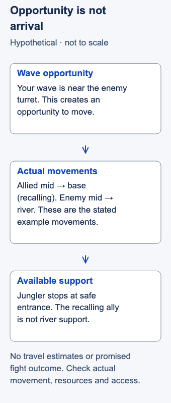

# Lane priority

- Stable lesson ID: MA04
- Slug: lane-priority
- Category: Macro
- Roles and level: All roles; beginner, especially Jungle, Mid and Support.
- Summary: Understand who can move first from lane and what that opportunity can support.
- Prerequisites: Wave crashing, Recalling, Map awareness.
- Observable action: Before entering a contest, identify the first ally who can realistically help.

## Short answer

Lane priority is a relative opportunity to act or move before the opposing laner. Wave position can help create it, but resources, routes and actual movement decide whether it supports the next play.

A pushed lane can create an opportunity to move. Check the player's wave duty, resources, route and actual movement before relying on that opportunity. Priority alone does not establish a favorable fight.

## Understand priority and check availability

**Lane priority** describes a relative opportunity to act or move before the opposing laner. It is not a displayed score. A **push** moves allied minions toward the enemy side; a **crash** brings them to the enemy turret. **Holding** limits wave movement, **building** lets allied minions accumulate, and **clearing** removes opposing minions. These choices affect what a laner gives up by leaving.

Dignitas connects pushing with an earlier move. Riot's objective design discussion describes lane control providing cover for junglers. These support the opportunity, while Tomo's coaching emphasizes adapting to teammate intentions and game state. [Dignitas, “When Do You Roam?”](https://dignitas.gg/articles/the-art-of-roaming-in-league-of-legends); [Riot, “Epic Objective Tuning”](https://www.leagueoflegends.com/en-gb/news/game-updates/patch-26-1-notes/); [Dignitas, “What Can You Get Away With in 2v2?”](https://dignitas.gg/articles/adc-mindset-guide-with-dig-tomo).

To decide whether that priority can support the play you are considering, check it in this order:

1. **Identify the lane duty.** Is your ally collecting a wave, pushing, defending a turret or already leaving? A wave under the enemy turret may reduce a reason to stay, but the enemy can still abandon farm to move.
2. **Check readiness.** Look at health, mana or equivalent resources, and known available abilities. A nearby ally who cannot survive the approach may offer little practical help. Compare what the player can do after joining, not just whether they can walk there.
3. **Trace both arrival routes.** Which ally and enemy can reach the play first? Consider obstructions, dangerous entrances and observed movement. Do not count an unseen enemy as absent.
4. **Use actual behavior.** A ping requests help; it does not confirm it. If the ally recalls, stays to farm or takes another route, revise the play before crossing into danger.

Movement spends lane income, health and map presence. Solo queue calls should adapt to the players visibly available. Coordinated teams can confirm who moves and who covers the abandoned duty. Even confirmed help does not settle combat strength, enemy reinforcements or escape safety.

## Hypothetical example

You are the jungler considering a river contest. Your mid laner has pushed a wave toward the enemy turret, so you expect help. Looking again, you see your ally retreating to recall while the enemy mid laner walks toward river.

Your ally's wave position created an opportunity they chose to spend on recovery. You stop at a safe entrance instead of entering the contest as though mid were beside you. If your ally later returns ready to move, you assess the new situation; the earlier push is no longer enough information.

<!-- Figure: MA04; use one width variant at a time. -->

*The pushed wave creates an opportunity; the ally’s recall means that opportunity is not river support.*

Figure files: [desktop SVG](../visuals/assets/ma04-desktop.svg) · [mobile SVG](../visuals/assets/ma04-mobile.svg) · [desktop PNG](../visuals/previews/ma04-desktop.png) · [mobile PNG](../visuals/previews/ma04-mobile.png).

## Going deeper

**Priority is the right to move first.** A lane with priority can leave to help a fight or objective before the opponent can follow. That is why priority in mid and the lanes near an objective matters so much.

**Priority depends on the wave and the matchup.** A pushed wave gives priority; a champion with strong waveclear gets it more easily. Your team's plan should use the lanes that can move first.

**Spend it, do not waste it.** Having priority but staying in lane after the wave crashes leaves the advantage unused. Ward, help your jungler or move to the next objective.

## Common mistake and correction

**Mistake:** Counting two pushed lanes as two guaranteed teammates in a fight.

**Correction:** Name the actual first arrival and a reason each nearby player might stay. If support depends on someone changing their current action, treat it as unconfirmed and preserve an exit.

## Practice

Before three river entries in a replay, pause in player view. Predict the first reinforcements and write why one nearby ally might remain in lane. Then reveal movement and record whether the available information should have changed your entry.

The observable check is three explicit arrival assessments, including any required adjustment. Prediction accuracy is descriptive; this teaching proposal has no validated target and does not promise contest wins.

## Related lessons

[Wave crashing](../macro/MA16-wave-crashing.md) · [Recalling](../macro/MA02-recalling.md) · [Map awareness](../macro/MA39-map-awareness.md) · [Weak side](../macro/MA37-weak-side.md)

## Sources and limits

The cited passages support movement opportunity, lane cover and adaptation. The four checks and “usable priority” definition are editorial synthesis. Riot's dated notes supply official design context, not a complete current reward table. Enemy choices, unseen movement and changing resources limit every prediction. No exact arrival timer or fight-win claim is supplied.

Last independently reviewed and sources accessed: **3 November 2026 Pacific / 4 November 2026 UTC**. Source dates below are historical publication/update dates, not live-patch certification.

- Dignitas / Log; 16 Jan 2020.
- Riot Games / Riru, Sakaar; 7 Jan 2026.
- Dignitas / Myodo interviewing Tomo; 7 Dec 2025.

Editorial revision: concept scope updated for LEA-24 on 3 November 2026 Pacific. Prior review dates above refer to the inherited research package; revised prose received an integration review, not a new independent expert review. Examples and drills remain illustrative.
