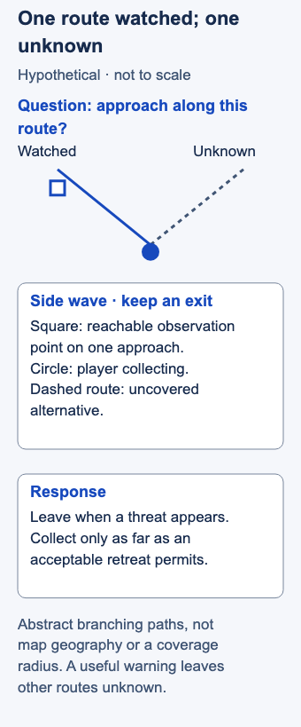

# Warding

- Stable lesson ID: MA05
- Slug: warding
- Category: Macro
- Roles and level: All roles; beginner, with Support and Jungle emphasis.
- Summary: Place vision where it can inform a decision, with safe access and a response.
- Prerequisites: Map awareness.
- Observable action: Before placing a ward, say what decision its information will change.

## Short answer

Warding is placing wards to gain information about areas of the map. Useful coverage depends on what you need to know, when you need it, and whether you can reach the spot safely. This introduction covers placement decisions, not every ward type or detection interaction.

Name your next question, choose safely reachable coverage that helps answer it, and decide how you will respond. One ward can inform a decision while leaving other approaches unknown.

## Connect coverage to a decision

**Fog of war** is the area your team cannot currently see. A ward provides **coverage**: information about part of the map under the game's vision rules. A **route** is an approach an enemy might use; a **choke** is a narrow passage. Seeing one route does not establish what is happening along every other route.

Biofrost's warding advice makes depth conditional on pressure and assistance, and warns against risking life for late objective vision. Isles' coaching connects map movement with useful information and time. [Dignitas, “Warding Around the Mid” and “Warding Around Dragon”](https://dignitas.gg/articles/pro-level-warding-guide-with-dignitas-biofrost); [Dignitas, section 3, “Managing your time around the map wisely”](https://dignitas.gg/articles/five-important-support-tricks-and-advice-with-isles).

The question-first process below is editorial synthesis:

1. **State the imminent decision.** “Can I keep collecting this side wave?” is more actionable than “I need more vision.” Choose a question that matters before your next move.
2. **Pick a relevant approach.** Ask where a warning would help you change that move. Consider the time and space your champion needs to retreat, without assuming a universal warning distance.
3. **Check access before depth.** Can you reach the spot without crossing an unchecked entrance? Count visible allies who can help, not an escort you hope will appear. Use closer useful coverage, wait for help or reduce the depth of your intended play when access is unsafe.
4. **Attach a response.** Decide what seeing an enemy would change. Also name an uncovered approach. Reassess when the ward is removed, coverage ends, or your next job changes.

Placement spends a ward, travel time and presence elsewhere. An empty covered route can still be useful information, but only within its coverage and the period you observed. Enemy mobility, stealth and alternate paths limit what that absence tells you. This lesson supplies no universal ward location or detection rule for those abilities.

## Hypothetical example

You want to collect a side wave. A reachable ward can watch an approach toward your retreat path. Your question is, “Will someone approach along this route while I collect?” Your planned response is to leave when a threat appears.

A second route remains uncovered. You collect only the portion of the wave that leaves an acceptable exit instead of treating the ward as permission to advance indefinitely. If placing the ward itself requires walking through an unknown choke, you wait or choose a closer location. The ideal-looking spot is not worth assuming safe access.

<!-- Figure: MA05; use one width variant at a time. -->

*A useful warning leaves other routes unknown.*

Figure files: [desktop SVG](../visuals/assets/ma05-desktop.svg) · [mobile SVG](../visuals/assets/ma05-mobile.svg) · [desktop PNG](../visuals/previews/ma05-desktop.png) · [mobile PNG](../visuals/previews/ma05-mobile.png).

## Going deeper

**Ward for a decision.** A ward is useful when it tells you something you will act on: a gank path, an objective entrance or a flank. Place wards before you need the information.

**Clear enemy vision too.** Removing enemy wards before objectives or ganks can be as important as placing your own. See the [Vision denial](MA19-vision-denial.md) lesson.

**Use wards with timers.** Wards placed before an objective spawns give your team the information to start or contest it safely.

## Common mistake and correction

**Mistake:** “I warded, so this area is safe.” You continue forward without checking what the ward can reveal.

**Correction:** Complete the sentence: “This watches ___; ___ remains unknown; I will ___ if the information changes.” A useful ward answers a bounded question. It does not remove every risk.

## Practice

For five wards in a replay, record the question and planned response before revealing later events. Check whether the coverage mattered while the decision was still active. Review at least one response to new information or ended coverage; if none occurred, note that and use another sample.

This proposed drill measures whether you gave the ward a purpose and used the result. It has no vision-score quota, validated success rate or requirement that an enemy cross the ward.

## Related lessons

[Map awareness](../macro/MA39-map-awareness.md) · [Vision denial](../macro/MA19-vision-denial.md)

## Sources and limits

Both coaching sources share the Dignitas publisher; they do not establish independent-publisher consensus. Exact current coverage, ward duration and historical placement diagrams are excluded. Any later precise placement illustration needs a current client check. The proposed question-and-response framework has not been tested for teaching efficacy.

Last independently reviewed and sources accessed: **3 November 2026 Pacific / 4 November 2026 UTC**. Source dates below are historical publication/update dates, not live-patch certification.

- Dignitas / Teatones interviewing Biofrost; 15 May 2022.
- Dignitas / Myodo interviewing Isles; 14 Aug 2025.

Editorial revision: concept scope updated for LEA-24 on 3 November 2026 Pacific. Prior review dates above refer to the inherited research package; revised prose received an integration review, not a new independent expert review. Examples and drills remain illustrative.
