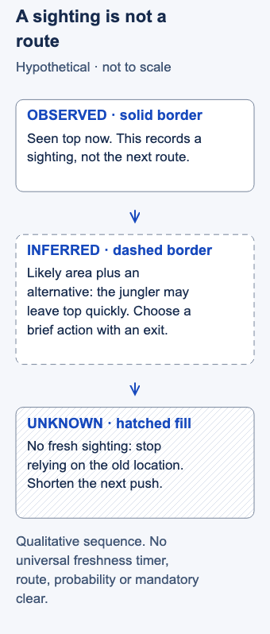

# Jungle tracking

- Stable lesson ID: MA06
- Slug: jungle-tracking
- Category: Macro
- Roles and level: Jungle and all laners; intermediate.
- Summary: Infer likely jungle movement from sightings while keeping uncertainty explicit.
- Prerequisites: Map awareness, Warding.
- Observable action: State a last sighting, a likely area, an alternative and the resulting decision as separate items.

## Short answer

Jungle tracking is using visible information to estimate a jungler’s location and possible next actions between sightings. It produces a prediction, not a view through fog of war.

Separate where the jungler was seen from where they might go next. Use the prediction to inform one decision, then revise it when new evidence arrives or the old sighting no longer supports it. “Unknown” is a useful answer.

## Separate observation from inference

An **observation** is something your team actually saw: the jungler appeared in a place at a particular game time. An **inference** is your explanation of what may follow. An **unknown** is a gap the evidence does not resolve. Fog hides choices between sightings; a plausible route is not an observed route.

Dignitas' tracking guide discusses sightings and likely camp sequencing. Tomo's coaching connects jungle information with judging whether a lane exchange may receive extra enemies. Those ideas support using information, but not exact route certainty. [Dignitas, “First Recall” and “Tracking Through Vision”](https://dignitas.gg/articles/how-to-track-the-enemy-jungler); [Dignitas, “What Can You Get Away With in 2v2?”](https://dignitas.gg/articles/adc-mindset-guide-with-dig-tomo).

The following uncertainty discipline is editorial synthesis, not a calibrated prediction model:

1. **Record what was seen.** Name location and game time. If a start location came from a guess, label it a guess. A teammate's old report retains its original age.
2. **Suggest a likely area and an alternative.** Use visible direction and opportunities you actually know about. The jungler may skip camps, attack a lane, enter the other jungle or return to base. Do not fill every hidden step with the route you expected.
3. **Connect it to one action.** You might continue briefly, hold a defensive ability, shorten a push, use another route or retreat. Name which risk the prediction changes and which risks remain.
4. **Update or return to unknown.** A new sighting may overturn the story. Time passing permits more possibilities; there is no universal freshness timer. Movement tools and unusual paths can make the old position less useful sooner than you expect.

In solo queue, communicate “last seen” and “may be” rather than issuing a certainty claim. Coordinated teams can pool sightings while retaining their times. Uncertainty does not require permanent retreat: excessive caution gives up pressure and income. Make the smallest commitment your current information supports and reassess.

## Hypothetical example

You see the enemy jungler top. Your observation is “seen top now.” Your inference is that some immediate bottom-side gank risk is reduced, subject to travel and movement tools. One alternative is that they leave top quickly rather than continue clearing there.

You take a brief bottom-lane action with an exit available. Later, without another sighting, you stop relying on the top appearance and shorten your next push. You never observed a full top-side clear, so “they must still be clearing top” would add information you do not have.

<!-- Figure: MA06; use one width variant at a time. -->

*Later choices must account for more possible locations.*

Figure files: [desktop SVG](../visuals/assets/ma06-desktop.svg) · [mobile SVG](../visuals/assets/ma06-mobile.svg) · [desktop PNG](../visuals/previews/ma06-desktop.png) · [mobile PNG](../visuals/previews/ma06-mobile.png).

## Common mistake and correction

**Mistake:** Turning one sighting into an exact camp sequence, then dismissing a surprising gank as impossible.

**Correction:** Keep an alternative and revisit the age of the observation. Review the prediction from player view before revealing the route. Spectator knowledge can explain the outcome afterward; it cannot justify a decision made without that knowledge.

## Practice

Pause a replay at three decisions before revealing hidden enemy movement. Write four fields: **seen / likely / alternative / my action**. Reveal the path afterward and record what new evidence should trigger an update. If a field was only a guess, mark it as such.

Check that all three records distinguish observation from inference and that later information changes the account when needed. Describe correct and incorrect area predictions without a target accuracy. This is an unvalidated teaching proposal.

## Related lessons

[Map awareness](../macro/MA39-map-awareness.md) · [Warding](../macro/MA05-warding.md) · [Lane priority](../macro/MA04-lane-priority.md)

## Sources and limits

The coaching evidence shares the Dignitas publisher. No independently calibrated prediction accuracy is claimed. CS arithmetic, mandatory full clears, exact expiry windows, item prescriptions and rank-based path assumptions are excluded. Current camp geography is entry knowledge, not verified route instruction from this article.

Last independently reviewed and sources accessed: **3 November 2026 Pacific / 4 November 2026 UTC**. Source dates below are historical publication/update dates, not live-patch certification.

- Dignitas / Famous; 29 Nov 2025.
- Dignitas / Myodo interviewing Tomo; 7 Dec 2025.

Editorial revision: concept scope updated for LEA-24 on 3 November 2026 Pacific. Prior review dates above refer to the inherited research package; revised prose received an integration review, not a new independent expert review. Examples and drills remain illustrative.
