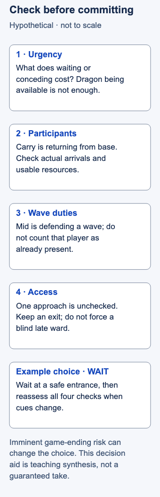

# Objective control

- Stable lesson ID: MA10
- Slug: objective-control
- Category: Macro
- Roles and level: All roles; intermediate, especially Jungle and Support.
- Summary: Use waves, resources, vision and access to influence neutral-objective contests.
- Prerequisites: Lane priority, Warding, Jungle tracking, Resets.
- Observable action: Before an objective commitment, state start, wait or leave with a reason tied to the available information.

## Short answer

Objective control is the ability to influence whether and how teams can take or contest an objective. For major neutral monsters, it involves lane pressure, prepared players, vision and access. Starting the monster is one possible use of control; waiting, denying access or conceding can also follow from the situation.

Before starting an epic objective, check who can actually help, whether they are ready, what nearby lanes need, and how enemies can approach. Choose start, wait or leave according to urgency and those conditions. Recheck when the situation changes.

## Control before the start

Control can exist before anyone attacks the monster. A team that can move from lane and safely watch entrances may have more options to start, threaten a start or turn toward approaching enemies. That advantage can disappear when players leave or resources run low. Vision informs those choices; it does not prevent an opponent from contesting.

This introduction focuses on preparation and the start decision. It does not cover every objective, exact rewards, pit execution or matchup-specific fights. Use the checks below to explain what control your team actually has.

## Prepare for a commitment

An **epic objective** here means a major neutral monster such as Dragon or Baron. A **reset** recovers resources and purchases; **priority** is an opportunity to act before an opposing laner. **Access** means the routes you can use and the information and protection available along them. A ward covering one approach leaves others uncertain. A last jungle sighting is a past observation, not a live location.

Riot's objective design discussion links commitment risk with lane cover. Dignitas' older objective-trading guide asks about strength, vision and numbers, while Biofrost's warding discussion warns against unsafe late access. [Riot, “Epic Objective Tuning”](https://www.leagueoflegends.com/en-gb/news/game-updates/patch-26-1-notes/); [Dignitas, “Dragon”](https://dignitas.gg/articles/an-eye-for-an-eye-tactics-for-trading-objectives); [Dignitas, “Warding Around Dragon”](https://dignitas.gg/articles/pro-level-warding-guide-with-dignitas-biofrost).

Use these four checks as an editorial decision aid:

1. **Urgency: what does waiting or conceding cost?** Consider the base, the enemy's route to winning and jobs available elsewhere. Routine caution may be inappropriate if conceding leaves no credible chance to continue the game. Availability alone is not a reason to start.
2. **Participants and resources: who can act now?** Count allies actually able to arrive, their health, mana or equivalent resources, and known useful abilities. Consider recovery and purchases early enough to return, without imposing a fixed setup countdown. A player walking from base is not already beside you.
3. **Wave duties: who can leave?** A wave is a group of lane minions; clearing removes opposing minions, while a crash brings your wave to the enemy turret. Check who is defending or collecting and what joining costs. Do not assume every lane can push or every pushed laner will join.
4. **Access: what can approach, and where can you leave?** Use sightings, covered routes and visible movement. Name the important unknown entrance or flank. If repairing vision requires entering darkness without protection, waiting safely or leaving can be preferable to forcing the setup.

Now choose **start**, **wait**, or **leave for another reachable job**. A start remains conditional: an ally departing or an enemy arriving can change it. Low damage, a threatened base or a blocked exit may invalidate the original call. Preparation also spends income and presence elsewhere; waiting for a perfect setup can miss the useful opportunity.

In solo queue, offer a simple call and adapt to actual participants. In coordinated play, confirm wave coverage and who calls continuing, fighting approaching opponents or leaving. This lesson chooses the commitment; it does not teach monster execution or Smite combinations.

## Hypothetical example

Dragon is available. Your bot carry is returning from base, your mid laner is defending a wave, and a river approach is unchecked. You choose **wait** at a safe entrance instead of starting on the assumption that both allies will arrive.

When the carry approaches, you reassess all four checks. If support still cannot arrive, you may leave for a reachable job. If conceding would leave the enemy with an imminent game-ending opportunity, a risky contest may be justified. The lesson is to explain that urgency explicitly, rather than silently applying the routine wait response to every situation.

<!-- Figure: MA10; use one width variant at a time. -->

*Choose the commitment after checking the situation, and revisit it when cues change.*

Figure files: [desktop SVG](../visuals/assets/ma10-desktop.svg) · [mobile SVG](../visuals/assets/ma10-mobile.svg) · [desktop PNG](../visuals/previews/ma10-desktop.png) · [mobile PNG](../visuals/previews/ma10-mobile.png).

## Common mistake and correction

**Mistake:** “It spawned, so we should start.” The team begins, then tries to repair missing allies and vision while committed.

**Correction:** Choose the call after the checks. Revisit it when conditions change. Do not risk a late blind ward solely to preserve a decision made before you checked access.

## After the objective

Recheck health, available allies, waves and enemy positions before choosing another action. Convert the gain into a feasible lane push, safer map access or a reset for the next task. Winning the monster does not make a chase safe. If no useful follow-up is available, recover and preserve the advantage.

## Practice

Review two objective commitments in player view. Before revealing outcomes, write the four checks and one justified choice: start, wait or leave. Then identify the first later cue that should change or confirm the call.

The observable check is two complete decision records. Winning the objective is not the training metric. This is a proposed teaching drill, not a validated method or promise of better results.

## Related lessons

[Lane priority](../macro/MA04-lane-priority.md) · [Warding](../macro/MA05-warding.md) · [Jungle tracking](../macro/MA06-jungle-tracking.md) · [Resets](../macro/MA23-resets.md) · [Sieging](../macro/MA34-sieging.md)

## Sources and limits

Both coaching pages are published by Dignitas. Riot provides official design context from dated notes, not independent validation of the whole checklist. The checklist and urgency exceptions are editorial synthesis. Historical reward values, fixed objective trades, exact timers, universal numbers advantages and guaranteed takes are excluded. No current client, match replay or teaching-efficacy test validates the example.

Last independently reviewed and sources accessed: **3 November 2026 Pacific / 4 November 2026 UTC**. Source dates below are historical publication/update dates, not live-patch certification.

- Riot Games / Riru, Sakaar; 7 Jan 2026.
- Dignitas / Wave; 6 Oct 2015.
- Dignitas / Teatones interviewing Biofrost; 15 May 2022.

Editorial revision: concept scope updated for LEA-24 on 3 November 2026 Pacific. Prior review dates above refer to the inherited research package; revised prose received an integration review, not a new independent expert review. Examples and drills remain illustrative.
