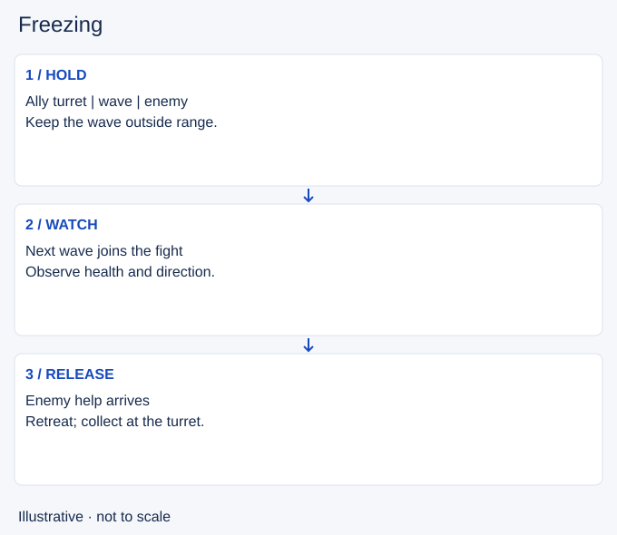

# Freezing

- Stable lesson ID: MA11
- Slug: freezing
- Category: Macro
- Roles and level: All roles; beginner to intermediate.
- Summary: Hold the wave in a useful place and recognise when the hold costs too much.
- Prerequisites: Wave bouncing.
- Observable action: Choose the position and reason for the hold: safer farming or making an opponent approach.

## Short answer

Freezing means keeping successive minion waves fighting near the same place. A common aim is to hold them outside your own turret range. You adjust damage to the wave instead of clearing every minion as soon as possible.

## How it works

A freeze needs a sustainable balance between the two waves. Last-hit, watch which side is winning, and thin an incoming wave if it would overwhelm the hold. Minion health, reinforcements and champion damage matter; a fixed minion count is not a universal recipe. Holding a wave can make the opponent walk farther forward to farm. It does not automatically stop them from gaining experience.

1. Choose the position and reason for the hold: safer farming or making an opponent approach.
2. Observe the next collision. If the enemy wave is too strong, reduce it; if your wave wins too quickly, reduce your extra attacks.
3. Reassess when an opponent approaches, help disappears or a nearby fight starts. Let the hold go if keeping it requires a bad trade.

## Hypothetical example

You want to farm near your turret while the enemy jungler is unseen. The wave is held outside turret range, but the opponent returns with help. You retreat and collect what reaches the turret. Losing the hold is cheaper than standing in front of two champions to preserve it.

<!-- Figure: MA11 -->

*Illustrative decision sequence for freezing; positions and timing are not game measurements.*

## Going deeper

**Freezes work best against a lane that needs to farm.** Denying minions hurts an opponent who relies on gold and experience to keep up. Against a champion who roams well, a freeze can let them leave lane freely.

**Holding the freeze.** When the enemy wave gets too small, the freeze breaks and the wave moves toward the enemy. Let a few more enemy minions arrive, or use [minion aggro](../micro/MI27-minion-aggro.md) to pull the wave back.

**Know when to break it.** Before you recall or roam, you usually want to push the wave instead, so you do not lose minions to your turret while you are away.

**Combine with your jungler.** An opponent forced to walk far up the lane to farm is easier to gank. Tell your jungler when you are holding a freeze.

## Common mistake and correction

**Mistake:** Treating the frozen wave as something you must protect at any cost.

**Correction:** Set a health and safety limit before trying to hold it. A freeze is a choice about lane resources, not an obligation to fight.

## Practice

In a replay, choose three wave collisions near your turret. Before each one, predict whether the meeting point will stay, move toward you or move away. Watch the result and identify the damage or reinforcement that changed it. Then name one event that would make you abandon the hold.

## Limits

This exercise evaluates observation, not a target number of denied minions. Enemy pressure can prevent a freeze. Holding also ties you to lane when teammates may need you elsewhere.

## Related lessons

[Wave bouncing](../macro/MA17-wave-bouncing.md) · [Recalling](../macro/MA02-recalling.md)

## Sources and limits

[Source and context](https://dignitas.gg/articles/how-to-improve-wave-management-for-every-lane-in-league-of-legends). The original Dignitas coaching guide by EkardD (6 July 2026) supports the basic hold, thinning and opportunity-cost concepts. Its exact minion recipes, seasonal rankings and promised advantages are not adopted.

Sources checked 4 November 2026. Examples and exercises are teaching proposals, not tested performance guarantees. No live patch certification or independent expert review is claimed.
