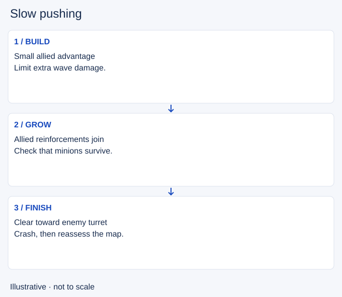

# Slow pushing

- Stable lesson ID: MA12
- Slug: slow-pushing
- Category: Macro
- Roles and level: All roles; beginner to intermediate.
- Summary: Build an advancing wave before deciding when to send it into the turret.
- Prerequisites: Wave management, Fast pushing.
- Observable action: Name the next use of the wave: a recall, a move toward river or pressure on the turret.

## Short answer

Slow pushing means letting an allied minion advantage advance gradually so more allied minions can join it. The aim is to build a wave before a later crash, when allied minions reach the enemy turret.

## How it works

Create or recognise a small allied advantage, then limit extra damage while last-hitting. Check whether the wave is actually growing. When you need it to reach the turret, clear the remaining resistance. Opponents can thin the wave or contest you, so a planned buildup can fail.

1. Name the next use of the wave: a recall, a move toward river or pressure on the turret.
2. Watch the buildup rather than following a fixed number of waves. Compare the remaining health and incoming reinforcements.
3. Choose a finish point. If the map changes before you can complete the crash, reconsider the plan instead of defending it blindly.

## Hypothetical example

You plan to build a wave and recall. Before the wave reaches the enemy turret, your jungler asks for help nearby. You see that leaving now would leave the wave unfinished and the route is unsafe. You signal that you cannot join immediately. The wave plan helps explain your choice; it does not make the jungler wait.

<!-- Figure: MA12 -->

*Illustrative decision sequence for slow pushing; positions and timing are not game measurements.*

## Common mistake and correction

**Mistake:** Continuing to build because a guide said to stack a certain number of waves.

**Correction:** Use the next action as the goal. A bigger wave is useful only when you can use the time or pressure it creates.

## Practice

Pause a replay before a wave starts advancing. Write down the intended next action and one reason to cancel it. Watch until the next wave arrives. Record whether your extra attacks helped the buildup or cleared too quickly, and whether your next action was still useful.

## Limits

This is a planning drill, not a guaranteed recall or dive setup. A large wave does not remove enemy champion threats. If you cannot protect the buildup safely, accept a smaller wave or a different plan.

## Related lessons

[Wave management](../macro/MA40-wave-management.md) · [Fast pushing](../macro/MA13-fast-pushing.md) · [Wave crashing](../macro/MA16-wave-crashing.md)

## Sources and limits

[Source and context](https://dignitas.gg/articles/how-to-improve-wave-management-for-every-lane-in-league-of-legends). Dignitas’s original wave-management guide supports gradual buildup followed by a crash. The scenario, cancellation checks and practice method here are editorial teaching examples; no fixed wave count or seasonal claim is prescribed.

Sources checked 4 November 2026. Examples and exercises are teaching proposals, not tested performance guarantees. No live patch certification or independent expert review is claimed.
