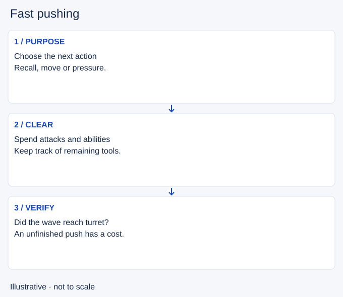

# Fast pushing

- Stable lesson ID: MA13
- Slug: fast-pushing
- Category: Macro
- Roles and level: All roles; beginner to intermediate.
- Summary: Clear a wave quickly to create time for a specific next action.
- Prerequisites: Wave management, Resource management.
- Observable action: Choose the action you want after the push. Check whether there is still time to take it.

## Short answer

Fast pushing, also called shoving, means clearing enemy minions quickly so your wave advances. A common goal is a crash at the enemy turret before you recall or leave lane.

## How it works

Use available attacks and suitable wave-clear abilities, but account for the resources and defensive tools you spend. Clearing the current enemies is not proof of a completed crash: a new wave or an opponent can stop your minions before the turret.

1. Choose the action you want after the push. Check whether there is still time to take it.
2. Compare your ability to finish with the enemy’s ability to contest. Keep an escape or stop if the push becomes unsafe.
3. Observe where your wave ends. If it is held short of the turret, reassess the cost of leaving rather than assuming the lane is solved.

## Hypothetical example

You clear the visible wave to recall, but enemy reinforcements arrive before your minions reach the turret. Your health is low and the enemy laner is returning. You take the safe recall and accept a possible lane cost. Staying for a perfect crash would risk more than the missed farm.

<!-- Figure: MA13 -->

*Illustrative decision sequence for fast pushing; positions and timing are not game measurements.*

## Common mistake and correction

**Mistake:** Using every ability on the wave, then walking into river as if those abilities were still ready.

**Correction:** Check resources again after the clear. The next play must work with what you have left.

## Practice

Review three times you cleared and left lane. Pause at departure and describe the actual wave position. Classify each as a completed crash, an unfinished push or unclear. Then check whether your intended next action was available and what tools you had left for it.

## Limits

There is no universal clear-time target. Champion tools, wave health, enemy interference and travel distance change the result. A safe exit can be correct even when the push is incomplete; name the cost rather than pretending it vanished.

## Related lessons

[Wave management](../macro/MA40-wave-management.md) · [Resource management](../micro/MI16-resource-management.md) · [Slow pushing](../macro/MA12-slow-pushing.md)

## Sources and limits

[Source and context](https://dignitas.gg/articles/how-to-improve-wave-management-for-every-lane-in-league-of-legends). Dignitas’s guide supports quick clearing, the cost in abilities and the risk of a failed push. The departure audit and hypothetical example are editorial synthesis. Current damage values and exact recall timings are outside this lesson.

Sources checked 4 November 2026. Examples and exercises are teaching proposals, not tested performance guarantees. No live patch certification or independent expert review is claimed.
