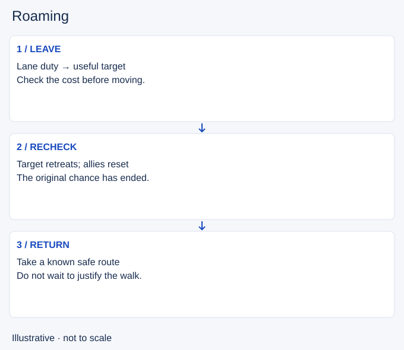

# Roaming

- Stable lesson ID: MA14
- Slug: roaming
- Category: Macro
- Roles and level: All roles; beginner to intermediate.
- Summary: Leave lane with a purpose, a safe route and a return condition.
- Prerequisites: Lane priority, Jungle tracking, Tempo.
- Observable action: State the purpose and compare it with the lane cost. Check health, resources and who can actually join.

## Short answer

Roaming means leaving your lane to affect another area of the map. A roam can support a teammate, threaten a gank or help secure vision. It spends time that could otherwise go to lane income and defence.

## How it works

Start with the duty you leave behind. A push may create room to move, but an enemy can follow or pressure the lane. Supports must also consider whether their lane partner can stay safely. Choose a destination that still offers value when you arrive. A kill is not the only useful outcome, and walking farther is not proof of progress.

1. State the purpose and compare it with the lane cost. Check health, resources and who can actually join.
2. Choose a route using observed enemies and vision. An unseen entrance is uncertain, even when it is the shortest path.
3. Set a return condition before departure. Cancel if the target retreats, allies disengage or the lane needs you back.

## Hypothetical example

After pushing mid, you move toward a possible bot-lane gank. Halfway there, the enemy bot lane backs away and your allies start recalling. You return through a known safe route instead of waiting in a bush for the original opportunity to return. The cancellation prevents a speculative roam from becoming a long absence.

<!-- Figure: MA14 -->

*Illustrative decision sequence for roaming; positions and timing are not game measurements.*

## Common mistake and correction

**Mistake:** Staying because you have already spent time walking.

**Correction:** Decide from the remaining opportunity and cost. Time already spent does not make the next minute worthwhile.

## Practice

For three replay roams, stop at departure and write a purpose, expected lane cost and return condition. Resume in player view. Note the first visible change that should confirm or cancel the move. Compare your actual return with that moment.

## Limits

This drill measures whether you update a plan. It does not promise successful ganks. Enemy vision and communication remain uncertain; avoid treating a ping as confirmed help.

## Related lessons

[Lane priority](../macro/MA04-lane-priority.md) · [Jungle tracking](../macro/MA06-jungle-tracking.md) · [Tempo](../macro/MA22-tempo.md) · [Lane assignments](../macro/MA25-lane-assignments.md)

## Sources and limits

[Source and context](https://dignitas.gg/articles/the-art-of-roaming-in-league-of-legends). Log’s original Dignitas roaming guide (16 January 2020) supports moving to influence another area, pushing for an opportunity and considering the lane partner. Its old item advice, role restrictions and risk-taking prescriptions are not adopted. Return conditions and drills are editorial synthesis.

Sources checked 4 November 2026. Examples and exercises are teaching proposals, not tested performance guarantees. No live patch certification or independent expert review is claimed.
