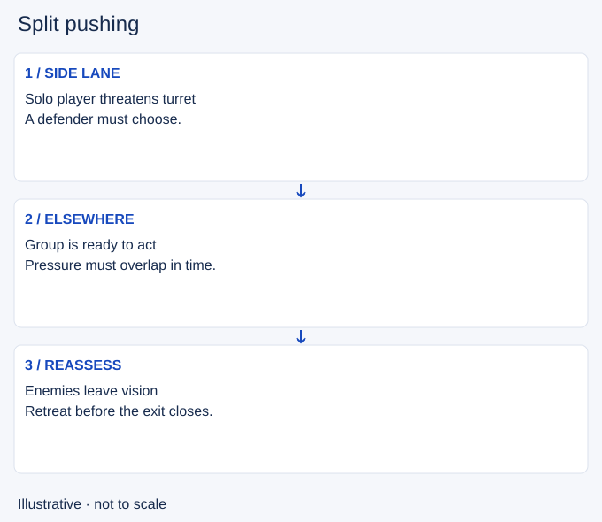

# Split pushing

- Stable lesson ID: MA15
- Slug: split-pushing
- Category: Macro
- Roles and level: All roles; beginner to intermediate.
- Summary: Coordinate side-lane pressure with what teammates can do elsewhere.
- Prerequisites: Rotations, Jungle tracking.
- Observable action: Check the group’s position and readiness before advancing. State what they could gain if an enemy answers you.

## Short answer

Split pushing means applying lane pressure apart from the main group so the enemy must divide attention. A common shape is one player in a side lane and four elsewhere. The value comes from connected pressure across the map.

## How it works

The side player needs a credible threat and a way to respond when enemies move. The group needs a useful action while defenders are occupied, or enough safety to wait. Riot describes split pushing as a strategic alternative to a full team fight, with rotations and fights as counterplay. Being alone in a side lane is not enough to create that tradeoff.

1. Check the group’s position and readiness before advancing. State what they could gain if an enemy answers you.
2. Track visible defenders and possible approaches. Move back while you still have an exit when missing enemies could reach you.
3. Reassess the exchange. If the group is recalling or cannot hold safely, delay pressure or regroup rather than demanding that they survive.

## Hypothetical example

You reach a side wave while your teammates are still buying items. Advancing to the turret now would let enemies focus on you without giving anything up elsewhere. You collect safely and wait for your group to take position. Later, a defender appears against you; you reassess the duel and your teammates’ opportunity before moving farther.

<!-- Figure: MA15 -->

*Illustrative decision sequence for split pushing; positions and timing are not game measurements.*

## Common mistake and correction

**Mistake:** Blaming the group for losing a fight while assuming any side-lane farm counted as useful pressure.

**Correction:** Compare timing and actual threats. Ask what the enemy had to give up to answer you, and whether your group could act then.

## Practice

Review three side-lane advances. Pause before crossing into danger and mark the group’s position, visible defenders and your exit. State one useful action available to the group. If you cannot name one, record why you continued and what you could have done instead.

## Limits

A strong duelist can still be caught, and the group can be forced into a fight. No formation guarantees a profitable trade. This lesson does not prescribe current items, Teleport timings or champion matchups.

## Related lessons

[Rotations](../macro/MA24-rotations.md) · [Jungle tracking](../macro/MA06-jungle-tracking.md) · [Cross-map trading](../macro/MA26-cross-map-trading.md)

## Sources and limits

[Source and context](https://www.leagueoflegends.com/en-us/news/dev/quick-gameplay-thoughts-march-19/). Riot Scruffy’s Split Pushing Goals (19 March 2021) is primary design context for solo pressure, distributed formations and counterplay. The timing audit, example and drill are editorial synthesis, not a claim about the current strongest strategy.

Sources checked 4 November 2026. Examples and exercises are teaching proposals, not tested performance guarantees. No live patch certification or independent expert review is claimed.
