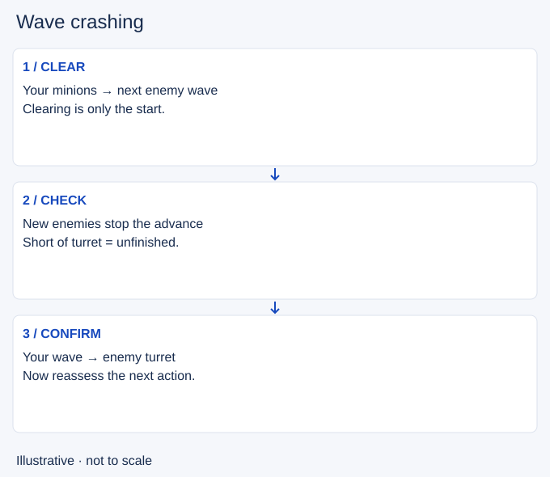

# Wave crashing

- Stable lesson ID: MA16
- Slug: wave-crashing
- Category: Macro
- Roles and level: All roles; beginner to intermediate.
- Summary: Confirm that a push reaches the turret before spending the time it creates.
- Prerequisites: Fast pushing, Slow pushing.
- Observable action: Choose why you want the crash: a recall, movement or pressure.

## Short answer

A wave crash occurs when an advancing minion wave reaches the enemy turret and is taken up by its defence. Fast pushing describes how you clear; crashing describes where the wave ends.

## How it works

An opponent or arriving wave can stop a push short. Watch the actual meeting point before leaving.

1. Choose why you want the crash: a recall, movement or pressure.
2. Check whether you can finish safely before another wave or enemy arrives.
3. Observe the wave reaching the turret, then recheck your next action.

## Hypothetical example

You clear mid and plan to help in river. Your minions stop against new enemies outside the turret. Your teammate retreats, so you abandon the river move. You now decide whether to finish the push or recall based on your health; the original plan no longer decides for you.

<!-- Figure: MA16 -->

*Illustrative decision sequence for wave crashing; positions and timing are not game measurements.*

## Common mistake and correction

**Mistake:** Calling every cleared wave a crash.

**Correction:** Check the minions, not just your last attack.

## Practice

In three replay departures, pause before leaving lane. Draw the turret and the wave meeting point. Predict whether the push will finish without you. Watch to the next collision and record what stopped or completed it.

## Limits

A crash does not guarantee a free recall or a safe roam. An enemy can still intercept you. Do not risk a death just to make the wave picture look correct.

## Related lessons

[Fast pushing](../macro/MA13-fast-pushing.md) · [Slow pushing](../macro/MA12-slow-pushing.md) · [Wave bouncing](../macro/MA17-wave-bouncing.md)

## Sources and limits

[Source and context](https://dignitas.gg/articles/how-to-improve-wave-management-for-every-lane-in-league-of-legends). EkardD’s original coaching guide supports the distinction between clearing and completing a crash. No fixed wave number or timing is adopted.

Sources checked 4 November 2026. Examples and exercises are teaching proposals, not tested performance guarantees. No live patch certification or independent expert review is claimed.
