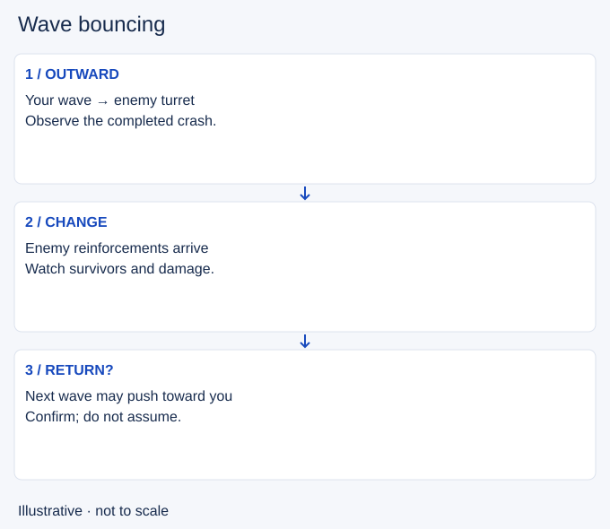

# Wave bouncing

- Stable lesson ID: MA17
- Slug: wave-bouncing
- Category: Macro
- Roles and level: All roles; beginner to intermediate.
- Summary: Read the returning wave after a crash instead of assuming an automatic reset.
- Prerequisites: Wave crashing.
- Observable action: Observe what survives the crash and where reinforcements meet.

## Short answer

A wave bounce is a reversal in the direction of a lane’s push, commonly after a wave crashes. The next waves can begin moving back toward the player who pushed.

## How it works

Arriving reinforcements, surviving minions and champion damage determine the next direction. A crash can set up a return push; it does not guarantee one.

1. Observe what survives the crash and where reinforcements meet.
2. Predict the next push direction before adding damage.
3. Recheck after the opponent clears or holds the wave.

## Hypothetical example

You return from base expecting the lane to come toward you. Instead, your opponent clears quickly and the waves meet near the centre. You change your farming position to match what is visible instead of standing where a remembered sequence says the wave should be.

<!-- Figure: MA17 -->

*Illustrative decision sequence for wave bouncing; positions and timing are not game measurements.*

## Common mistake and correction

**Mistake:** Attacking every returning minion while expecting the wave to keep moving toward you.

**Correction:** Decide whether to collect, hold or push before adding extra damage.

## Practice

Choose three replay crashes. Hide the future timeline, predict the next meeting point, and name the uncertainty. Watch two collisions. Record one event that confirmed or changed your prediction.

## Limits

The return can be disrupted. This is an observation exercise, not a fixed minion recipe or a promise that a recall loses no farm.

## Related lessons

[Wave crashing](../macro/MA16-wave-crashing.md) · [Freezing](../macro/MA11-freezing.md)

## Sources and limits

[Source and context](https://dignitas.gg/articles/how-to-improve-wave-management-for-every-lane-in-league-of-legends). EkardD’s guide describes a crash followed by a return wave. Conditions and replay exercises here are teaching synthesis, not a universal sequence.

Sources checked 4 November 2026. Examples and exercises are teaching proposals, not tested performance guarantees. No live patch certification or independent expert review is claimed.
