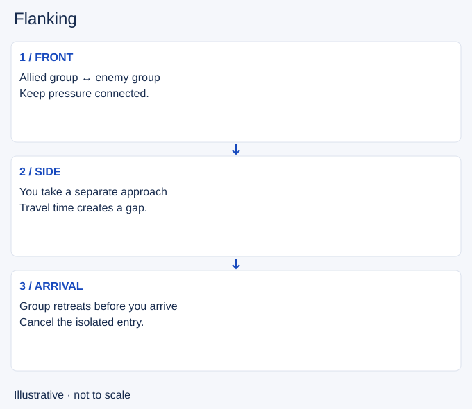

# Flanking

- Stable lesson ID: MA18
- Slug: flanking
- Category: Macro
- Roles and level: All roles; beginner to intermediate.
- Summary: Use a side approach without arriving alone or too late.
- Prerequisites: Engaging, Vision denial.
- Observable action: Choose an angle and identify when the group can apply pressure.

## Short answer

Flanking means approaching from a side or rear angle instead of joining the main front. It can change which opponents you can reach and where they can retreat.

## How it works

A flank costs travel time and separates you from allies. Coordinate the arrival with the group’s pressure. A hidden route is useful only if you can reach a useful position safely; lack of visible enemies does not prove the route is clear.

1. Choose an angle and identify when the group can apply pressure.
2. Check route information and preserve a way out.
3. Recheck before revealing yourself; leave if the group retreats.

## Hypothetical example

You move around a river wall while teammates face the enemy in lane. Before you arrive, your group backs away. Entering now would make you the only threat. You return by a known route and look for another window.

<!-- Figure: MA18 -->

*Illustrative decision sequence for flanking; positions and timing are not game measurements.*

## Common mistake and correction

**Mistake:** Taking the longest unseen route simply because it reaches the backline.

**Correction:** Compare arrival time with the group’s ability to stay in the fight.

## Practice

Review three side approaches. Pause at departure and at arrival. Mark your group’s position at both times. Explain whether the two threats overlapped, and identify the first moment you could have cancelled.

## Limits

Enemy vision may reveal you. A side angle is not automatically better for your champion, and leaving the group can expose an ally.

## Related lessons

[Engaging](../micro/MI13-engaging.md) · [Vision denial](../macro/MA19-vision-denial.md) · [Collapsing](../macro/MA32-collapsing.md)

## Sources and limits

[Source and context](https://dignitas.gg/articles/5-tips-to-improve-your-teamfighting-ft-team-dignitas). The original guide uses team positioning and a flank example to explain coordinated fight roles. Routes and cancellation exercises here are hypothetical.

Sources checked 4 November 2026. Examples and exercises are teaching proposals, not tested performance guarantees. No live patch certification or independent expert review is claimed.
