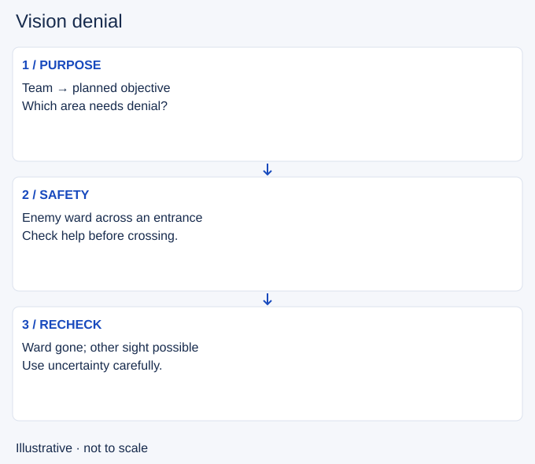

# Vision denial

- Stable lesson ID: MA19
- Slug: vision-denial
- Category: Macro
- Roles and level: All roles; beginner to intermediate.
- Summary: Remove enemy information when your team can safely use the uncertainty.
- Prerequisites: Warding.
- Observable action: Name the next action that benefits from denying information.

## Short answer

Vision denial means reducing the enemy’s ability to observe an area, often by finding and clearing their wards. It complements warding: one gives your team information, while the other limits the enemy’s.

## How it works

Choose the area around your next action. Enter with enough information and support to leave safely. Clearing one ward does not prove that every route is unseen. Enemy champions and other sources of vision may still reveal you.

1. Name the next action that benefits from denying information.
2. Check entrances and nearby allies before approaching a ward.
3. After clearing, reassess what the enemy can still see and what your team can do.

## Hypothetical example

Your group wants to approach an objective. A ward is visible across an unsafe entrance. Instead of walking alone to remove it, you wait for allies and check nearby threats. If the group recalls, you abandon the clear because the next action has changed.

<!-- Figure: MA19 -->

*Illustrative decision sequence for vision denial; positions and timing are not game measurements.*

## Common mistake and correction

**Mistake:** Walking into danger because a ward is a guaranteed small reward.

**Correction:** Compare the clear with the risk and the team action it supports.

## Practice

For three ward-clearing attempts, pause before entry. Name the intended benefit, possible enemy approach and exit. After the clear, check whether the team used the area or whether the attempt only consumed time.

## Limits

Removal tools have different detection rules. This lesson does not claim that one tool reveals all wards, traps or stealth. Check current tool descriptions in game.

## Related lessons

[Warding](../macro/MA05-warding.md) · [Jungle tracking](../macro/MA06-jungle-tracking.md)

## Sources and limits

[Source and context](https://oce.leagueoflegends.com/en/featured/preseason-2017/assassins). Riot’s historical season update establishes Control Wards as an anti-vision tool. It is design context, not evidence of current ranges or detection rules. The route audit is editorial guidance.

Sources checked 4 November 2026. Examples and exercises are teaching proposals, not tested performance guarantees. No live patch certification or independent expert review is claimed.
