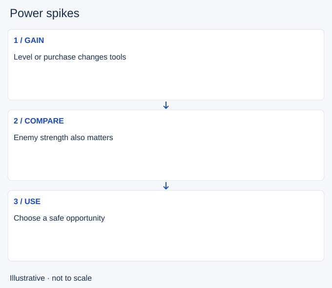

# Power spikes

- Stable lesson ID: MA20
- Slug: power-spikes
- Category: Macro
- Roles and level: All roles; beginner to intermediate.
- Summary: Recognise a meaningful increase in usable strength.
- Prerequisites: Experience, Itemization.
- Observable action: Identify the new tool or purchase.

## Short answer

A power spike is a point where a champion gains a significant new advantage, often from a level, ability unlock or completed purchase. Its value is relative to the opponent and the fight you can actually take.

## How it works

Look for a change that affects the next interaction: a new tool, more survivability or enough damage to threaten. Gold in your inventory is not the same as an item already bought. Compare the opponent's visible level and items, then check whether your advantage can be used safely.

1. Identify the new tool or purchase.
2. Compare the opponent's current strength.
3. Choose a useful action while the advantage matters.

## Hypothetical example

You return with a completed item while your opponent still holds components. You can pressure more, but their jungler appears nearby. You keep the advantage for a safer exchange instead of forcing a fight into two opponents.

<!-- Figure: MA20 -->

*Illustrative decision sequence for power spikes; arrows show decisions, not measured game positions or timing.*

## Common mistake and correction

**Mistake:** Treating a strong level or item as permission to fight anywhere.

**Correction:** Combine the strength change with map information and access.

## Practice

Review three purchases or level-ups. State exactly what each change enables, then identify an available action and one reason to delay it. Avoid judging only by whether you won the next fight.

## Limits

Spikes vary by champion and patch. This lesson does not claim a fixed winning level, item or matchup.

## Related lessons

[Experience](../macro/MA38-experience.md) · [Itemization](../macro/MA21-itemization.md) · [Warding](../macro/MA05-warding.md)

## Sources and limits

[Riot: How to Play](https://www.leagueoflegends.com/en-us/how-to-play/). Primary context for levels, purchases, structures and the base objective. It does not validate the decision routine taught here.

Checked 4 November 2026. The explanations, hypothetical scenarios, diagrams and exercises are editorial teaching guidance. Source context is not proof that a drill improves rank. No patch-specific numbers or independent expert review are claimed.
