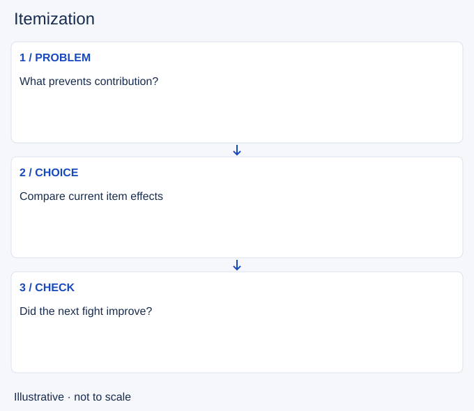

# Itemization

- Stable lesson ID: MA21
- Slug: itemization
- Category: Macro
- Roles and level: All roles; beginner to intermediate.
- Summary: Choose purchases to solve a specific problem in the match.
- Prerequisites: Recalling.
- Observable action: Name the problem the purchase should solve.

## Short answer

Itemization is selecting purchases and their order to support your champion's job against the current threats. It includes deciding whether an immediate component or a later completed item best serves the next action.

## How it works

Identify what stops you contributing: insufficient damage, lack of survival or a particular enemy tool. Read current item effects and compare useful stats rather than buying from memory alone. A counter purchase can help, but giving up too much of your main function also has a cost.

1. Name the problem the purchase should solve.
2. Read the current effect and price.
3. Check how the purchase changes your next fight.

## Hypothetical example

You repeatedly die before using your second spell rotation. At the shop you compare a defensive option with more damage. You choose based on the damage source and your team job, not merely the last player who killed you.

<!-- Figure: MA21 -->

*Illustrative decision sequence for itemization; arrows show decisions, not measured game positions or timing.*

## Common mistake and correction

**Mistake:** Copying a build without checking the opposing threats.

**Correction:** Keep a default plan but explain any change with a match-specific reason.

## Practice

Review two recalls. Record the problem you intended to solve, your chosen purchase and a plausible alternative. Watch the next fight for evidence that the purchase affected that problem.

## Limits

Items and prices change. No best-build or current numerical recommendation is made here; use the in-game shop for details.

## Related lessons

[Recalling](../macro/MA02-recalling.md) · [Power spikes](../macro/MA20-power-spikes.md)

## Sources and limits

[Riot: How to Play](https://www.leagueoflegends.com/en-us/how-to-play/). Primary context for levels, purchases, structures and the base objective. It does not validate the decision routine taught here.

Checked 4 November 2026. The explanations, hypothetical scenarios, diagrams and exercises are editorial teaching guidance. Source context is not proof that a drill improves rank. No patch-specific numbers or independent expert review are claimed.
