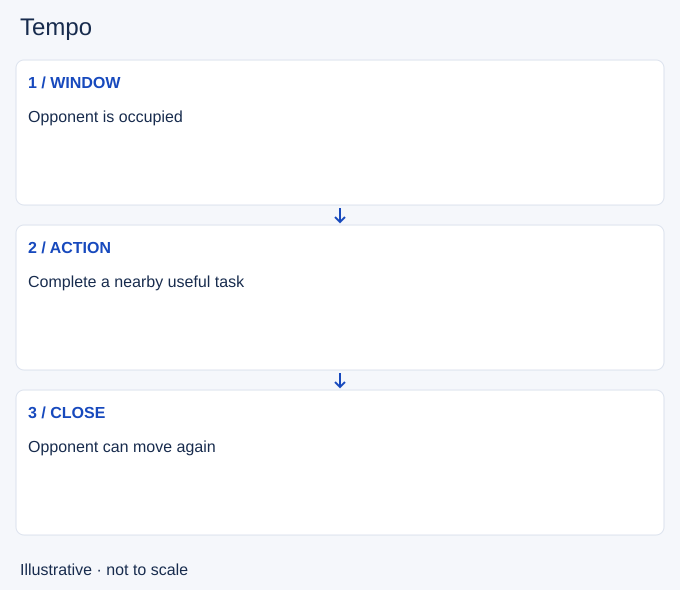

# Tempo

- Stable lesson ID: MA22
- Slug: tempo
- Category: Macro
- Roles and level: All roles; beginner to intermediate.
- Summary: Use a window to act while the opponent must respond elsewhere.
- Prerequisites: Lane priority, Recalling.
- Observable action: Identify what currently delays the opponent.

## Short answer

Tempo is a temporary advantage in the timing of useful actions. You may be able to move first while an opponent clears a wave, returns from base or answers pressure. The advantage expires as they finish that task.

## How it works

A tempo lead needs an action you can complete within the window. Moving first without a destination can waste it. Include travel, health, resource and return costs. The opponent may choose to give up the wave and follow, so keep watching rather than assuming they are occupied.

1. Identify what currently delays the opponent.
2. Choose an action that fits the likely window.
3. Finish or leave when they regain freedom to move.

## Hypothetical example

You crash a wave and move to help establish nearby vision. The opponent clears faster than expected and leaves lane. You return with your teammate instead of extending the route as if the original window still held.

<!-- Figure: MA22 -->

*Illustrative decision sequence for tempo; arrows show decisions, not measured game positions or timing.*

## Going deeper

**Tempo is doing useful things in less time.** Teams that recall together, move with pushed waves and arrive at objectives first create tempo. Teams that walk around without purpose lose it.

**Chain actions.** Push the wave, then ward, then help your jungler, then return for the next wave. Each action sets up the next instead of leaving gaps.

**Tempo can matter more than a kill.** A kill that costs a wave, a recall timing and the next objective may not be worth it. Look at what happens in the next minute, not only the result of the fight.

## Common mistake and correction

**Mistake:** Treating first movement as a permanent advantage.

**Correction:** Track when the other team can act again.

## Practice

Review three moves after a push or recall. Record the delaying task, your intended action and the moment the window closed. Note one unnecessary stop that consumed the window.

## Limits

Tempo is contextual, not a fixed number of seconds. A move can be early yet unsafe or useless.

## Related lessons

[Lane priority](../macro/MA04-lane-priority.md) · [Recalling](../macro/MA02-recalling.md) · [Resets](../macro/MA23-resets.md)

## Sources and limits

[Riot: Split Pushing Goals](https://www.leagueoflegends.com/en-us/news/dev/quick-gameplay-thoughts-march-19/). Primary design context for distributed pressure, rotations and counterplay. Its historical champion examples are not current matchup advice.

Checked 4 November 2026. The explanations, hypothetical scenarios, diagrams and exercises are editorial teaching guidance. Source context is not proof that a drill improves rank. No patch-specific numbers or independent expert review are claimed.
