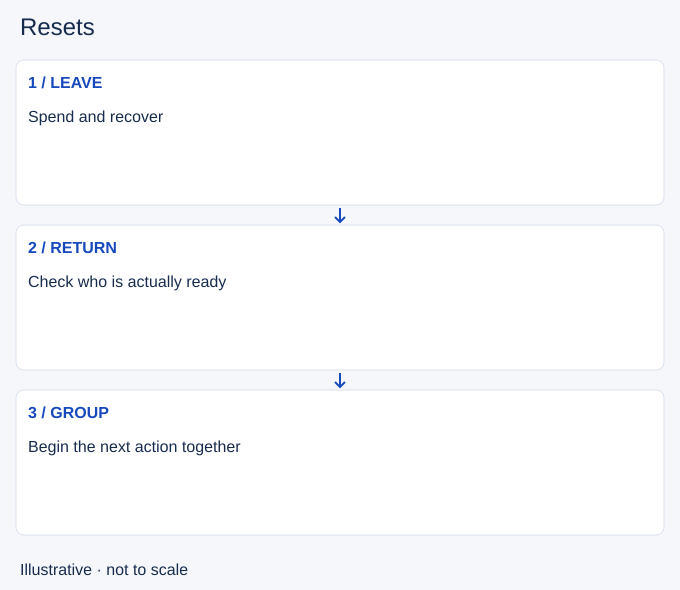

# Resets

- Stable lesson ID: MA23
- Slug: resets
- Category: Macro
- Roles and level: All roles; beginner to intermediate.
- Summary: Coordinate a return to base with the team's next action.
- Prerequisites: Recalling, Itemization, Tempo.
- Observable action: Check the next team action and who needs base.

## Short answer

A reset is a return to base to restore resources, make purchases and prepare to re-enter the map. This lesson focuses on team timing; Recalling covers the individual departure and channel decision.

## How it works

Check who needs to buy or recover before the next contest. If one player starts a fight while others reset, the team can lose access despite holding resources. Communicate the return and choose a realistic next meeting point. A synchronised reset still needs safe wave and map conditions.

1. Check the next team action and who needs base.
2. Leave with enough time to return usefully.
3. Wait for actual readiness before recommitting.

## Hypothetical example

Your team wins a small fight but has low health and unspent gold. You signal a reset before the next objective setup. One ally stays for a wave, so the group delays entering dark river until they can join.

<!-- Figure: MA23 -->

*Illustrative decision sequence for resets; arrows show decisions, not measured game positions or timing.*

## Common mistake and correction

**Mistake:** Assuming everyone is ready because you finished shopping.

**Correction:** Check positions and resources after the return.

## Practice

Review two team recalls before contests. Note each player's departure, return and first useful action. Identify whether staggered timing caused a fight or vision task to happen short-handed.

## Limits

Perfectly synchronised recalls are not always possible. Do not abandon a necessary defence merely to match the group.

## Related lessons

[Recalling](../macro/MA02-recalling.md) · [Itemization](../macro/MA21-itemization.md) · [Tempo](../macro/MA22-tempo.md) · [Roaming](../macro/MA14-roaming.md)

## Sources and limits

[Riot: Split Pushing Goals](https://www.leagueoflegends.com/en-us/news/dev/quick-gameplay-thoughts-march-19/). Primary design context for distributed pressure, rotations and counterplay. Its historical champion examples are not current matchup advice.

Checked 4 November 2026. The explanations, hypothetical scenarios, diagrams and exercises are editorial teaching guidance. Source context is not proof that a drill improves rank. No patch-specific numbers or independent expert review are claimed.
