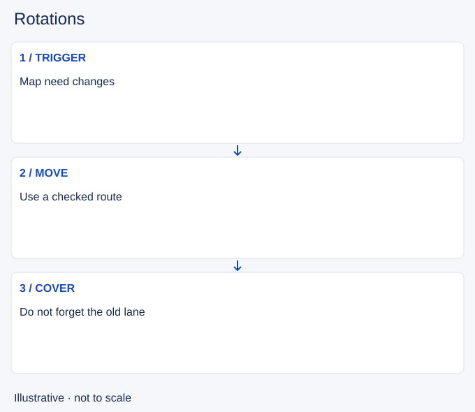

# Rotations

- Stable lesson ID: MA24
- Slug: rotations
- Category: Macro
- Roles and level: All roles; beginner to intermediate.
- Summary: Move players between areas to meet a changed map need.
- Prerequisites: Lane assignments, Tempo.
- Observable action: Name the map need and the player suited to it.

## Short answer

A rotation is a move from one map area to another to change who attacks, defends or collects resources there. It has value when the new position serves a more useful purpose than the duty you leave.

## How it works

Identify the destination and the coverage lost at the origin. Compare routes using vision, travel and possible interceptions. A rotation is not complete when you start walking: the arriving players must still be useful, and someone may need to cover the vacated lane.

1. Name the map need and the player suited to it.
2. Check the route and the duty left behind.
3. Reassess the destination before arrival.

## Hypothetical example

An enemy shifts toward mid after a side turret falls. You move to help defend mid while an ally collects the safer side wave. When the enemy backs away, you stop grouping unnecessarily and restore lane coverage.

<!-- Figure: MA24 -->

*Illustrative decision sequence for rotations; arrows show decisions, not measured game positions or timing.*

## Common mistake and correction

**Mistake:** Moving toward teammates without a defined task.

**Correction:** State what your arrival changes and who covers your previous area.

## Practice

Review three lane-to-lane moves. Record the map trigger, destination job and uncovered resource. Compare the useful time at destination with the travel and missed income.

## Limits

Fast movement is not always better. A rotation through unsafe terrain can cost more than the threatened structure.

## Related lessons

[Lane assignments](../macro/MA25-lane-assignments.md) · [Tempo](../macro/MA22-tempo.md) · [Split pushing](../macro/MA15-split-pushing.md)

## Sources and limits

[Riot: Split Pushing Goals](https://www.leagueoflegends.com/en-us/news/dev/quick-gameplay-thoughts-march-19/). Primary design context for distributed pressure, rotations and counterplay. Its historical champion examples are not current matchup advice.

Checked 4 November 2026. The explanations, hypothetical scenarios, diagrams and exercises are editorial teaching guidance. Source context is not proof that a drill improves rank. No patch-specific numbers or independent expert review are claimed.
