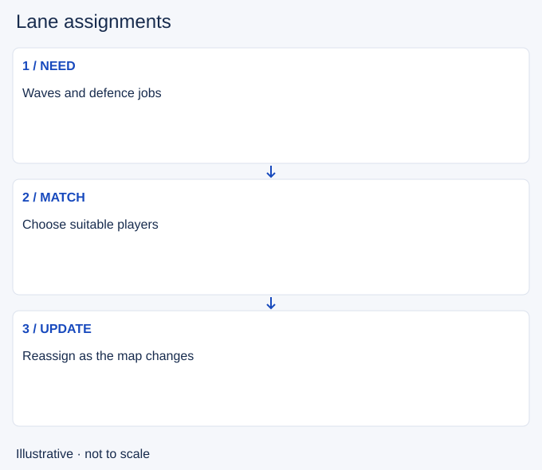

# Lane assignments

- Stable lesson ID: MA25
- Slug: lane-assignments
- Category: Macro
- Roles and level: All roles; beginner to intermediate.
- Summary: Distribute players so waves and map duties have an owner.
- Prerequisites: Wave management, Weak side.
- Observable action: List the waves and urgent defence jobs.

## Short answer

Lane assignments describe which players collect or defend each lane while others handle vision, jungle resources or group pressure. Assignments change as structures fall and objectives become relevant.

## How it works

Consider who can survive the lane, clear its wave and reach the next team action. Sending the strongest duelist far away is not useful if the group cannot safely wait. Avoid several players competing for the same safe wave while another lane threatens your base.

1. List the waves and urgent defence jobs.
2. Match each to a suitable available player.
3. Reassign when enemies move or a contest approaches.

## Hypothetical example

Two carries approach mid while a side wave reaches your turret. One collects mid and the other takes the safe side defence with a return plan. The support stays near the area where vision is needed rather than claiming a wave by default.

<!-- Figure: MA25 -->

*Illustrative decision sequence for lane assignments; arrows show decisions, not measured game positions or timing.*

## Common mistake and correction

**Mistake:** Treating the opening lane as a permanent assignment.

**Correction:** Choose roles from the current map needs and champion tools.

## Practice

Pause a replay at three mid-game wave arrivals. Assign one player to each useful job and explain safety and travel. Compare that plan with any duplicated or abandoned duty.

## Limits

Solo-queue teammates may not follow the same plan. Adapt to observed movement instead of assuming a ping settled ownership.

## Related lessons

[Wave management](../macro/MA40-wave-management.md) · [Weak side](../macro/MA37-weak-side.md) · [Rotations](../macro/MA24-rotations.md)

## Sources and limits

[Riot: Split Pushing Goals](https://www.leagueoflegends.com/en-us/news/dev/quick-gameplay-thoughts-march-19/). Primary design context for distributed pressure, rotations and counterplay. Its historical champion examples are not current matchup advice.

Checked 4 November 2026. The explanations, hypothetical scenarios, diagrams and exercises are editorial teaching guidance. Source context is not proof that a drill improves rank. No patch-specific numbers or independent expert review are claimed.
