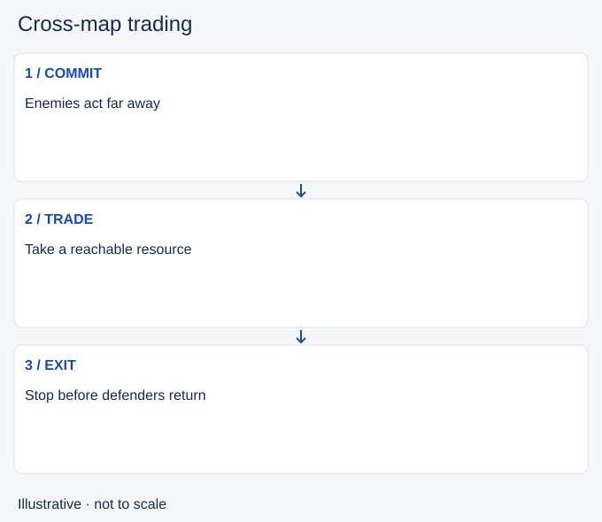

# Cross-map trading

- Stable lesson ID: MA26
- Slug: cross-map-trading
- Category: Macro
- Roles and level: All roles; beginner to intermediate.
- Summary: Take a useful resource elsewhere when a direct contest is poor.
- Prerequisites: Split pushing, Tempo.
- Observable action: Check whether direct help can arrive usefully.

## Short answer

Cross-map trading means gaining something in one part of the map while the enemy spends time or players elsewhere. It is an alternative to arriving late at a fight you are unlikely to improve.

## How it works

Compare what is truly available, what the enemy is gaining and how long you have before they can return. A visible enemy commitment can create room, but missing opponents may still defend your target. Tell teammates when you cannot contest and choose a realistic trade with a safe exit.

1. Check whether direct help can arrive usefully.
2. Identify a reachable resource on the other side.
3. Leave before the enemy can close the route.

## Hypothetical example

Most enemies appear at a distant objective while you are near an undefended side wave. You push toward a turret with a visible escape, then leave when enemies disappear. You do not keep hitting merely to make the exchange look equal.

<!-- Figure: MA26 -->

*Illustrative decision sequence for cross-map trading; arrows show decisions, not measured game positions or timing.*

## Common mistake and correction

**Mistake:** Calling any farming a good trade without comparing losses.

**Correction:** Name the gain, the loss and the chance of completing it.

## Practice

Review three uncontested enemy objectives. Using only player-view information, list possible trades and their travel costs. Check whether your chosen gain was available before the window closed.

## Limits

Some losses are too costly to accept, especially threats to the base. Not every objective has a safe equivalent elsewhere.

## Related lessons

[Split pushing](../macro/MA15-split-pushing.md) · [Tempo](../macro/MA22-tempo.md) · [Positioning](../micro/MI12-positioning.md)

## Sources and limits

[Riot: Split Pushing Goals](https://www.leagueoflegends.com/en-us/news/dev/quick-gameplay-thoughts-march-19/). Primary design context for distributed pressure, rotations and counterplay. Its historical champion examples are not current matchup advice.

Checked 4 November 2026. The explanations, hypothetical scenarios, diagrams and exercises are editorial teaching guidance. Source context is not proof that a drill improves rank. No patch-specific numbers or independent expert review are claimed.
