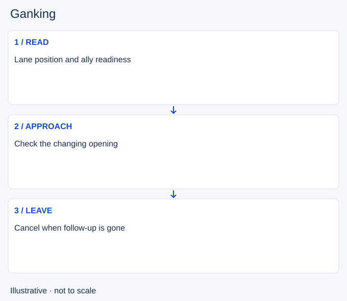

# Ganking

- Stable lesson ID: MA27
- Slug: ganking
- Category: Macro
- Roles and level: All roles; beginner to intermediate.
- Summary: Approach a lane to create a useful local advantage.
- Prerequisites: Jungle pathing, Crowd control, Summoner spells.
- Observable action: Check whether the lane can follow up.

## Short answer

Ganking is moving into a lane to help attack an opponent, usually from outside their immediate lane fight. The aim can be a kill, a forced retreat or relief for an ally, but the attempt costs time and resources.

## How it works

Check ally readiness, enemy position, likely vision and escape routes. A favourable position can disappear during travel. Arriving when your ally is too low to help can make the apparent numbers advantage misleading. Choose the approach and the point at which waiting is no longer worthwhile.

1. Check whether the lane can follow up.
2. Approach using the information you have.
3. Leave when the opening ends or help cannot arrive.

## Hypothetical example

You approach a pushed lane, but your ally recalls before you reach it. You stop outside enemy vision and return to another task. The earlier lane position does not justify attacking alone now.

<!-- Figure: MA27 -->

*Illustrative decision sequence for ganking; arrows show decisions, not measured game positions or timing.*

## Common mistake and correction

**Mistake:** Waiting indefinitely for the enemy to walk forward.

**Correction:** Set a departure condition before entering the route.

## Practice

Review three gank approaches. At departure and arrival, record ally readiness, enemy escape and visible information. Note which changed during travel and whether you updated the plan.

## Limits

Vision and reinforcement information are incomplete. No route or champion guarantees a successful gank.

## Related lessons

[Jungle pathing](../macro/MA29-jungle-pathing.md) · [Crowd control](../micro/MI21-crowd-control.md) · [Summoner spells](../micro/MI26-summoner-spells.md) · [Counterganking](../macro/MA28-counterganking.md)

## Sources and limits

[Novalas / Dignitas: When should I gank?](https://dignitas.gg/articles/blogs/League-of-Legends/7931/jungle-when-should-i-gank). Original coaching context for lane readiness, escape tools and countergank risk (2015). Old routes, timings, items and matchup claims are excluded.

Checked 4 November 2026. The explanations, hypothetical scenarios, diagrams and exercises are editorial teaching guidance. Source context is not proof that a drill improves rank. No patch-specific numbers or independent expert review are claimed.
