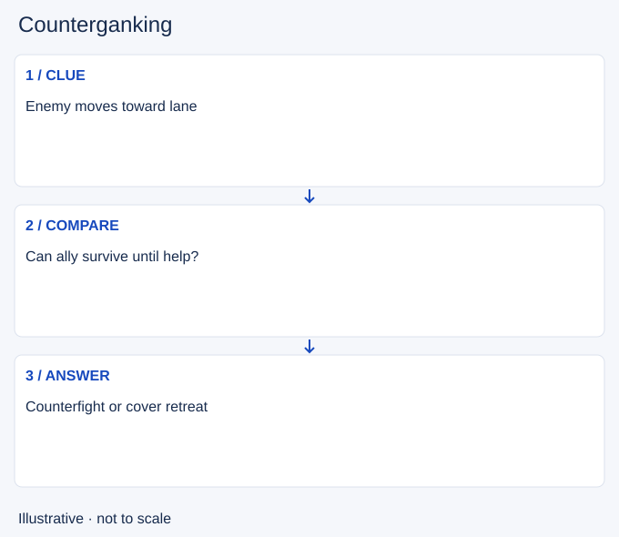

# Counterganking

- Stable lesson ID: MA28
- Slug: counterganking
- Category: Macro
- Roles and level: All roles; beginner to intermediate.
- Summary: Prepare to answer an enemy gank with nearby support.
- Prerequisites: Ganking, Jungle tracking.
- Observable action: Separate evidence of a gank from a guess.

## Short answer

Counterganking means arriving to turn or limit an enemy gank. It relies on anticipating an attack and being close enough to affect it, while avoiding a long wait for an event that may never happen.

## How it works

Use observed enemy movement, lane exposure and ally condition to form a hypothesis. Check whether you win the likely fight and whether your ally can survive until you act. Sometimes the useful answer is a warning and retreat instead of a hidden counterattack.

1. Separate evidence of a gank from a guess.
2. Compare arrival time and ally survival.
3. Prepare a response or warn the ally to leave.

## Hypothetical example

You see the enemy jungler enter the river toward an exposed lane. You are nearby, but your laner is low and has no exit. You signal retreat and cover their path rather than wait for them to be engaged on.

<!-- Figure: MA28 -->

*Illustrative decision sequence for counterganking; arrows show decisions, not measured game positions or timing.*

## Common mistake and correction

**Mistake:** Assuming every predicted gank should be fought.

**Correction:** Choose prevention when the counterfight lacks the tools to work.

## Practice

Review two enemy ganks. Pause at the last visible clue and estimate whether you could arrive in time. Compare a counterfight, warning and alternative task without using hidden replay information.

## Limits

A correct prediction can still lead to a losing fight. Observation and combat strength are separate questions.

## Related lessons

[Ganking](../macro/MA27-ganking.md) · [Jungle tracking](../macro/MA06-jungle-tracking.md) · [Invading](../macro/MA30-invading.md)

## Sources and limits

[Novalas / Dignitas: When should I gank?](https://dignitas.gg/articles/blogs/League-of-Legends/7931/jungle-when-should-i-gank). Original coaching context for lane readiness, escape tools and countergank risk (2015). Old routes, timings, items and matchup claims are excluded.

Checked 4 November 2026. The explanations, hypothetical scenarios, diagrams and exercises are editorial teaching guidance. Source context is not proof that a drill improves rank. No patch-specific numbers or independent expert review are claimed.
