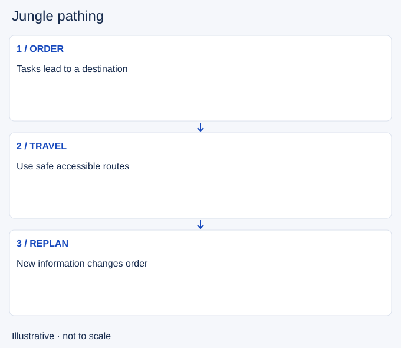

# Jungle pathing

- Stable lesson ID: MA29
- Slug: jungle-pathing
- Category: Macro
- Roles and level: All roles; beginner to intermediate.
- Summary: Order jungle tasks around access, resources and the next opportunity.
- Prerequisites: Jungle tracking, Lane priority.
- Observable action: Choose a useful destination after the next tasks.

## Short answer

Jungle pathing is choosing the order and route of camps, lane visits and map tasks. A path is a plan for useful movement, not a fixed sequence you must finish when conditions change.

## How it works

Start with available camps and the area where you want to finish. Consider health, ability resources, lane readiness and observed enemy movement. Recheck after each task. Detouring for a weak opportunity can waste travel, while refusing a strong nearby opportunity can also cost value.

1. Choose a useful destination after the next tasks.
2. Check accessible camps and safe routes.
3. Update the order when visible information changes.

## Hypothetical example

You plan to clear toward bot, but mid needs a safe escort after a fight. You compare the short detour with your camp plan and help them leave, then resume from the nearest useful task rather than returning to an obsolete route.

<!-- Figure: MA29 -->

*Illustrative decision sequence for jungle pathing; arrows show decisions, not measured game positions or timing.*

## Common mistake and correction

**Mistake:** Following a memorised clear regardless of the map.

**Correction:** Keep a default route and explicit reasons to change it.

## Practice

Review one early jungle sequence. At each departure, name the next task, destination afterward and visible reason for any detour. Compare wasted travel with a plausible alternative route.

## Limits

Camp timings, clear speeds and champion starts vary. This lesson gives no current optimal clear or spawn schedule.

## Related lessons

[Jungle tracking](../macro/MA06-jungle-tracking.md) · [Lane priority](../macro/MA04-lane-priority.md) · [Ganking](../macro/MA27-ganking.md)

## Sources and limits

[Riot: Preseason 2023 Jungle Changes](https://www.leagueoflegends.com/en-us/news/dev/lol-pls-preseason-2023-jungle-changes/). Primary historical context for balancing camp farming, ganks, vision and pathing. Proposed mechanics and old clear rules are excluded; the decision routine is editorial guidance.

Checked 4 November 2026. The explanations, hypothetical scenarios, diagrams and exercises are editorial teaching guidance. Source context is not proof that a drill improves rank. No patch-specific numbers or independent expert review are claimed.
