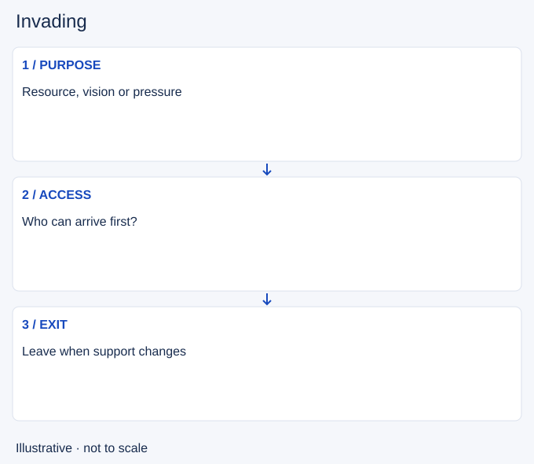

# Invading

- Stable lesson ID: MA30
- Slug: invading
- Category: Macro
- Roles and level: All roles; beginner to intermediate.
- Summary: Enter enemy territory with support, a purpose and an exit.
- Prerequisites: Jungle pathing, Lane priority, Warding.
- Observable action: Name the task inside enemy territory.

## Short answer

Invading means entering the enemy jungle to contest resources, gain information or pressure an opponent. Crossing the river is not itself an advantage; you need a useful task and a way out if defenders arrive.

## How it works

Check nearby lane movement, observed enemy locations and your resources. An ally being near does not mean they can leave a wave or survive the fight. Plan the exit before committing deep, and update it as enemies disappear from vision.

1. Name the task inside enemy territory.
2. Check which allies and enemies can arrive first.
3. Leave when the task ends or support becomes uncertain.

## Hypothetical example

You see the opposing jungler far away and approach a nearby camp. Their mid laner disappears while yours is under pressure. You leave before finishing because the original access condition has changed.

<!-- Figure: MA30 -->

*Illustrative decision sequence for invading; arrows show decisions, not measured game positions or timing.*

## Common mistake and correction

**Mistake:** Treating the enemy jungler's absence as proof the jungle is empty.

**Correction:** Track nearby laners and routes too.

## Practice

Review three entries into enemy jungle. At the boundary, name purpose, reachable help and exit. Identify the first visible change that should end the attempt.

## Limits

Unknown enemies can still be present. A level or item lead does not remove the cost of isolation.

## Related lessons

[Jungle pathing](../macro/MA29-jungle-pathing.md) · [Lane priority](../macro/MA04-lane-priority.md) · [Warding](../macro/MA05-warding.md) · [Counterjungling](../macro/MA31-counterjungling.md)

## Sources and limits

[Riot: Champion Counterplay](https://www.leagueoflegends.com/en-us/news/dev/quick-gameplay-thoughts-may-14/). Primary context for invading as strategic counterplay. The routing, gank and camp-trade routines here are editorial applications, not Riot prescriptions.

Checked 4 November 2026. The explanations, hypothetical scenarios, diagrams and exercises are editorial teaching guidance. Source context is not proof that a drill improves rank. No patch-specific numbers or independent expert review are claimed.
