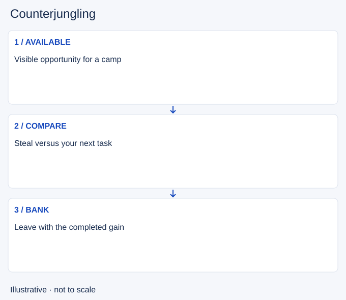

# Counterjungling

- Stable lesson ID: MA31
- Slug: counterjungling
- Category: Macro
- Roles and level: All roles; beginner to intermediate.
- Summary: Take enemy camps when the resource and escape are available.
- Prerequisites: Invading.
- Observable action: Check camp availability and enemy information.

## Short answer

Counterjungling is taking enemy jungle resources to gain income and reduce what the opposing jungler can collect. It is one possible purpose of an invade, not a requirement to hunt the enemy champion.

## How it works

Confirm the camp exists and compare the time to take it with other available tasks. Keep track of nearby lane movement and the return path. A stolen camp can be a poor exchange if you lose your own resources or arrive late to an important defence.

1. Check camp availability and enemy information.
2. Compare the steal with your own tasks.
3. Finish only while the exit remains credible.

## Hypothetical example

The enemy jungler shows on the opposite side. You take a nearby camp, but do not walk deeper for another when nearby laners leave vision. You keep the completed gain rather than risking it on an uncertain extension.

<!-- Figure: MA31 -->

*Illustrative decision sequence for counterjungling; arrows show decisions, not measured game positions or timing.*

## Common mistake and correction

**Mistake:** Assuming a stolen camp is always a winning exchange.

**Correction:** Include travel, missed tasks and danger in the comparison.

## Practice

Review two steals and one abandoned attempt. Record known camp availability, alternative task and exit condition. Compare the whole sequence, not just the gold from the camp.

## Limits

Exact respawn and camp rules can change. This lesson does not prescribe leaving a specific monster alive or any reset trick.

## Related lessons

[Invading](../macro/MA30-invading.md) · [Tempo](../macro/MA22-tempo.md)

## Sources and limits

[Riot: Preseason 2023 Jungle Changes](https://www.leagueoflegends.com/en-us/news/dev/lol-pls-preseason-2023-jungle-changes/). Primary historical context for balancing camp farming, ganks, vision and pathing. Proposed mechanics and old clear rules are excluded; the decision routine is editorial guidance.

Checked 4 November 2026. The explanations, hypothetical scenarios, diagrams and exercises are editorial teaching guidance. Source context is not proof that a drill improves rank. No patch-specific numbers or independent expert review are claimed.
