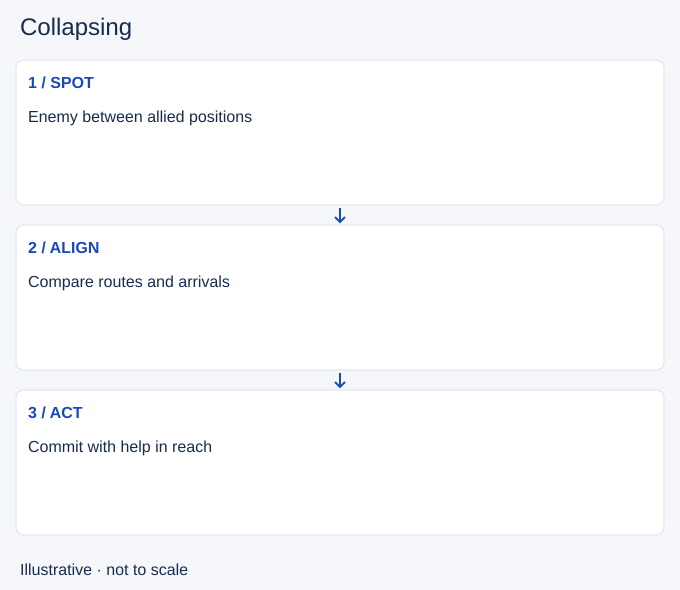

# Collapsing

- Stable lesson ID: MA32
- Slug: collapsing
- Category: Macro
- Roles and level: All roles; beginner to intermediate.
- Summary: Bring nearby allies onto a threat without arriving one at a time.
- Prerequisites: Flanking, Rotations.
- Observable action: Identify the enemy position and possible exits.

## Short answer

Collapsing means converging from different nearby positions onto an enemy or contested area. The advantage comes from coordinated arrival and useful access, not simply from several players walking toward the same marker.

## How it works

Check who can leave their current duty and which routes are safe. Compare arrival times before the first player commits. If the enemy can escape or isolate the earliest arrival, waiting or protecting an exit may be more useful than rushing directly at them.

1. Identify the enemy position and possible exits.
2. Compare ally routes and arrival times.
3. Commit when enough help can affect the fight.

## Hypothetical example

An enemy enters your jungle between two lanes. Both laners can move, but one is much farther away. The closer player holds a safe route rather than attacking alone, allowing the group to converge or let the enemy retreat.

<!-- Figure: MA32 -->

*Illustrative decision sequence for collapsing; arrows show decisions, not measured game positions or timing.*

## Common mistake and correction

**Mistake:** Counting moving allies as already present.

**Correction:** Fight with actual nearby help, not future numbers.

## Practice

Review three converging moves. Mark the first ally arrival, first commitment and next arrival. Identify whether the gap allowed an isolated death or an enemy escape.

## Limits

A collapse can cost lane resources and still fail. Do not chase indefinitely once the shared opportunity ends.

## Related lessons

[Flanking](../macro/MA18-flanking.md) · [Rotations](../macro/MA24-rotations.md) · [Win conditions](../macro/MA36-win-conditions.md)

## Sources and limits

[Riot: Split Pushing Goals](https://www.leagueoflegends.com/en-us/news/dev/quick-gameplay-thoughts-march-19/). Primary design context for distributed pressure, rotations and counterplay. Its historical champion examples are not current matchup advice.

Checked 4 November 2026. The explanations, hypothetical scenarios, diagrams and exercises are editorial teaching guidance. Source context is not proof that a drill improves rank. No patch-specific numbers or independent expert review are claimed.
