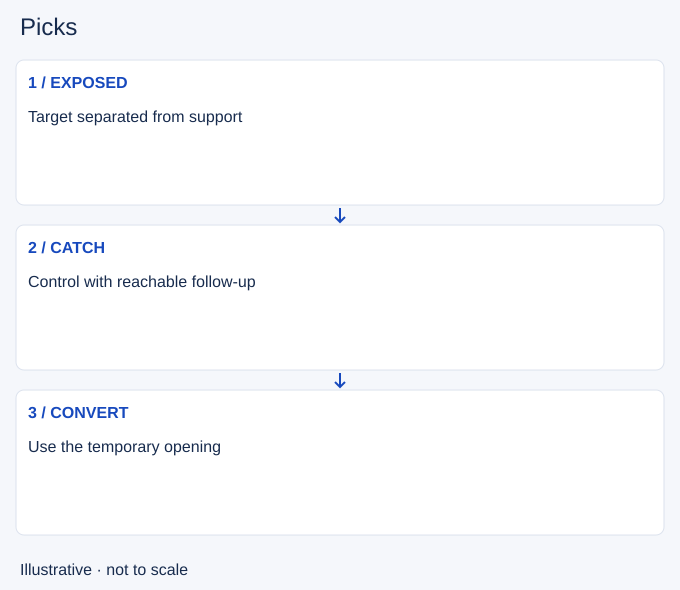

# Picks

- Stable lesson ID: MA33
- Slug: picks
- Category: Macro
- Roles and level: All roles; beginner to intermediate.
- Summary: Catch an exposed enemy and convert the opening into a useful action.
- Prerequisites: Win conditions, Collapsing.
- Observable action: Identify exposure and possible hidden help.

## Short answer

A pick is a catch on an isolated or vulnerable opponent that creates a temporary advantage for the team. It often begins before a full fight, when vision or positioning allows focused control and damage.

## How it works

Check that the target is truly exposed and that allies can follow. An apparently lone enemy may have unseen support. Plan what the catch would enable, such as a safe objective approach or a reset. Do not spend every resource chasing a target who no longer offers a useful opening.

1. Identify exposure and possible hidden help.
2. Check reliable follow-up and an exit.
3. After the catch, choose a concrete map action.

## Hypothetical example

Your group catches an enemy entering river alone. Instead of chasing the next opponent into darkness, you use the temporary advantage to establish vision and prepare the nearby objective with healthy teammates.

<!-- Figure: MA33 -->

*Illustrative decision sequence for picks; arrows show decisions, not measured game positions or timing.*

## Common mistake and correction

**Mistake:** Turning every catch into a long chase.

**Correction:** Convert the opening before the enemy regroups.

## Practice

Review three catches or attempts. Record the exposure, follow-up and action after it. Identify whether your team used the window or spent it chasing beyond its support.

## Limits

A single kill does not guarantee objective access. Resources, lanes and remaining enemies still matter.

## Related lessons

[Win conditions](../macro/MA36-win-conditions.md) · [Collapsing](../macro/MA32-collapsing.md) · [Objective control](../macro/MA10-objective-control.md)

## Sources and limits

[Riot: Split Pushing Goals](https://www.leagueoflegends.com/en-us/news/dev/quick-gameplay-thoughts-march-19/). Primary design context for distributed pressure, rotations and counterplay. Its historical champion examples are not current matchup advice.

Checked 4 November 2026. The explanations, hypothetical scenarios, diagrams and exercises are editorial teaching guidance. Source context is not proof that a drill improves rank. No patch-specific numbers or independent expert review are claimed.
