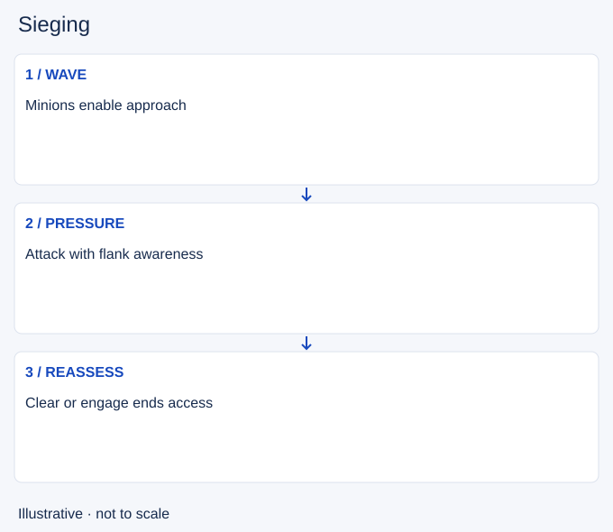

# Sieging

- Stable lesson ID: MA34
- Slug: sieging
- Category: Macro
- Roles and level: All roles; beginner to intermediate.
- Summary: Pressure a defended structure while controlling the approach.
- Prerequisites: Objective control, Poking, Disengaging.
- Observable action: Check the wave and the sides of the approach.

## Short answer

Sieging means applying sustained pressure to a defended structure with waves and champion threats. It is a contest over safe access: attackers need opportunities to damage the structure, while defenders try to clear waves or force a favourable fight.

## How it works

Bring a wave and check flanks before stepping up. Compare your ability to pressure with enemy wave clear and engagement tools. If each wave disappears before you can act, waiting in the same place may only expose your team. Rotate, reset or pressure another lane when the siege lacks progress.

1. Check the wave and the sides of the approach.
2. Damage the structure only from a useful position.
3. Reassess when defenders clear or threaten engagement.

## Hypothetical example

Your group reaches a turret with minions, but the defender clears them and an enemy vanishes from the side lane. You back away and reset vision instead of standing under the turret for one more attack.

<!-- Figure: MA34 -->

*Illustrative decision sequence for sieging; arrows show decisions, not measured game positions or timing.*

## Common mistake and correction

**Mistake:** Confusing proximity to a turret with productive pressure.

**Correction:** Measure safe damage or forced responses, and leave when neither is available.

## Practice

Review three waves at a defended turret. Note damage achieved, abilities spent and flank information. Explain whether another wave would improve the situation or repeat the same cost.

## Limits

Turret and minion mechanics vary with game state. This lesson gives no damage threshold for tanking structures.

## Related lessons

[Objective control](../macro/MA10-objective-control.md) · [Poking](../micro/MI18-poking.md) · [Disengaging](../micro/MI23-disengaging.md) · [Diving](../macro/MA35-diving.md)

## Sources and limits

[soduh / Dignitas: Poke Compositions](https://dignitas.gg/articles/team-composition-guide-to-poke-compositions-in-league-of-legends). Original coaching context distinguishing poke from siege and explaining disengage (2021). Historical builds, champion numbers and matchup prescriptions are excluded.

Checked 4 November 2026. The explanations, hypothetical scenarios, diagrams and exercises are editorial teaching guidance. Source context is not proof that a drill improves rank. No patch-specific numbers or independent expert review are claimed.
