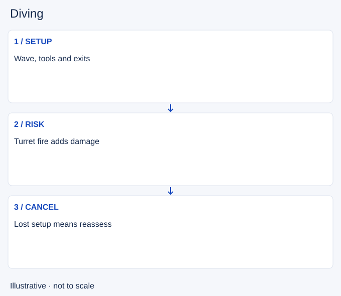

# Diving

- Stable lesson ID: MA35
- Slug: diving
- Category: Macro
- Roles and level: All roles; beginner to intermediate.
- Summary: Judge the extra risks of fighting under an enemy turret.
- Prerequisites: Sieging, All-ins, Summoner spells.
- Observable action: Check the defender's tools and reinforcement routes.

## Short answer

Diving is committing to fight an enemy under their turret. It adds structure damage and a restricted exit to the normal fight, so a low-health defender does not by itself make the attempt safe.

## How it works

Account for the wave, defender abilities, incoming help and who the turret is attacking. Agree on an exit before entry. Check current targeting behavior in game rather than assuming minions will always protect you. A dive can fail even after the target dies if attackers cannot leave.

1. Check the defender's tools and reinforcement routes.
2. Confirm wave position and who takes turret fire.
3. Leave before another attack makes the exchange worse.

## Hypothetical example

Two allies approach a low-health defender, but the wave is cleared before they enter. They cancel instead of continuing with the original plan. The missing wave changes access even though the enemy health has not changed.

<!-- Figure: MA35 -->

*Illustrative decision sequence for diving; arrows show decisions, not measured game positions or timing.*

## Common mistake and correction

**Mistake:** Using the defender's health as the whole decision.

**Correction:** Include turret exposure, tools and exit distance.

## Practice

Review two dives and one cancellation. Mark entry, turret target, defender response and exit. Compare the last safe cancellation point with the actual commitment.

## Limits

Turret targeting and champion interactions need current in-game verification. This lesson does not give a universal tank order or number of safe shots.

## Related lessons

[Sieging](../macro/MA34-sieging.md) · [All-ins](../micro/MI17-all-ins.md) · [Summoner spells](../micro/MI26-summoner-spells.md)

## Sources and limits

[Riot: How to Play](https://www.leagueoflegends.com/en-us/how-to-play/). Primary context for levels, purchases, structures and the base objective. It does not validate the decision routine taught here.

Checked 4 November 2026. The explanations, hypothetical scenarios, diagrams and exercises are editorial teaching guidance. Source context is not proof that a drill improves rank. No patch-specific numbers or independent expert review are claimed.
