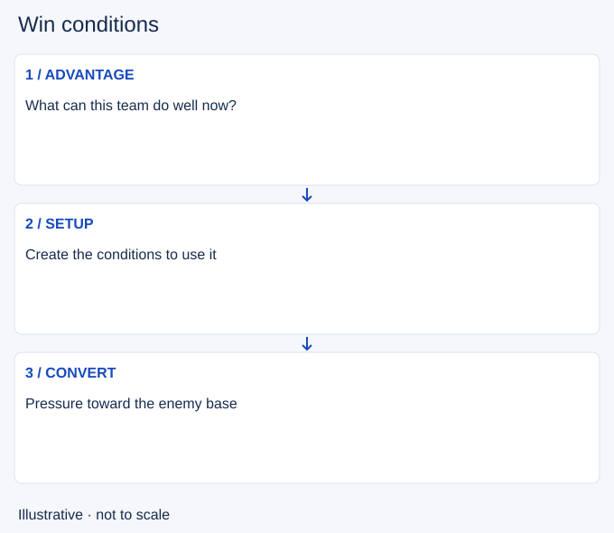

# Win conditions

- Stable lesson ID: MA36
- Slug: win-conditions
- Category: Macro
- Roles and level: All roles; beginner to intermediate.
- Summary: Choose the repeatable advantage your team can turn into a finish.
- Prerequisites: Split pushing, Target selection, Resets.
- Observable action: Identify the team's usable advantage.

## Short answer

A win condition is a plausible way your team can gain and convert enough advantage to destroy the enemy base. It might rely on team fights, side pressure, catches or sustained structure pressure, and it can change during the match.

## How it works

Compare team tools with the current map and resource state. A composition's intended strength is only useful if players can execute it now. Name the action that creates progress, the setup it needs and the enemy response that would stop it. Avoid defining the plan as simply getting more kills.

1. Identify the team's usable advantage.
2. Choose the setup that lets it matter.
3. Update the plan when key conditions disappear.

## When behind

A plan must fit your current strength. If you cannot safely contest, collect reachable resources, protect the next defensible position and wait for an observable opening. Do not enter dark terrain just because an objective is available. Reassess after purchases, returns to the map or enemy commitments; waiting needs a reason and a next check.

## Hypothetical example

Your team struggles in grouped fights but has a strong side-lane duelist. You coordinate side pressure while the group stays safe. When the duelist cannot advance safely, you stop treating that plan as automatic and look for a different opening.

<!-- Figure: MA36 -->

*Illustrative decision sequence for win conditions; arrows show decisions, not measured game positions or timing.*

## Common mistake and correction

**Mistake:** Following a pre-game plan despite changed resources.

**Correction:** Use current strengths and map access to revise it.

## Practice

Pause at three mid-game moments. Write one sentence naming the advantage, setup and next action. Then state the enemy response that would make you change plans.

## Limits

No composition guarantees a win. This is a planning exercise, not a current draft ranking or prediction model.

## Related lessons

[Split pushing](../macro/MA15-split-pushing.md) · [Target selection](../micro/MI22-target-selection.md) · [Resets](../macro/MA23-resets.md) · [Picks](../macro/MA33-picks.md)

## Sources and limits

[Riot: How to Play](https://www.leagueoflegends.com/en-us/how-to-play/). Primary context for levels, purchases, structures and the base objective. It does not validate the decision routine taught here.

Checked 4 November 2026. The explanations, hypothetical scenarios, diagrams and exercises are editorial teaching guidance. Source context is not proof that a drill improves rank. No patch-specific numbers or independent expert review are claimed.
