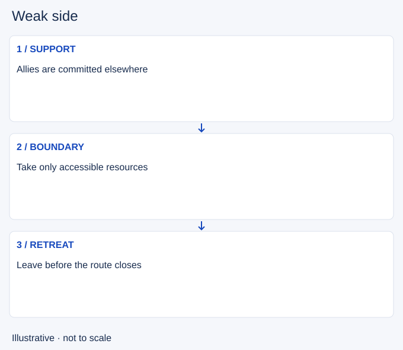

# Weak side

- Stable lesson ID: MA37
- Slug: weak-side
- Category: Macro
- Roles and level: All roles; beginner to intermediate.
- Summary: Play with limited nearby support while preserving useful resources.
- Prerequisites: Lane priority, Jungle tracking.
- Observable action: Check reachable allies and possible enemy arrivals.

## Short answer

Weak side describes an area receiving less immediate allied support than another area of the map. It is a relative allocation of attention and players, not a permanent label for a role or a command to lose lane.

## How it works

Compare who can reach your lane with who can reach the enemy's. Choose positions and farm that do not require help you do not have. Signal pressure early and give up a resource when protecting it would risk much more. Your team still needs to make useful progress elsewhere for the allocation to pay off.

1. Check reachable allies and possible enemy arrivals.
2. Choose a safe limit for farm and pressure.
3. Retreat before an unsupported defence becomes a trap.

## Hypothetical example

Your jungler and support are playing toward the opposite side. Two enemies could approach your lane, so you collect only what you can reach safely and retreat from a threatened turret. You communicate the loss rather than assume help will arrive.

<!-- Figure: MA37 -->

*Illustrative decision sequence for weak side; arrows show decisions, not measured game positions or timing.*

## Common mistake and correction

**Mistake:** Treating weak side as permission to stop gathering information.

**Correction:** Keep checking pressure and adjust the safety boundary.

## Practice

Review three moments with allies far away. Name what you could safely collect, the first warning of added pressure and your retreat point. Compare the conceded resource with the cost of staying.

## Limits

Being weak side does not make every concession correct. If enemies show elsewhere, a safe chance to farm or pressure can reopen.

## Related lessons

[Lane priority](../macro/MA04-lane-priority.md) · [Jungle tracking](../macro/MA06-jungle-tracking.md) · [Jungle pathing](../macro/MA29-jungle-pathing.md)

## Sources and limits

[Riot: Split Pushing Goals](https://www.leagueoflegends.com/en-us/news/dev/quick-gameplay-thoughts-march-19/). Primary design context for distributed pressure, rotations and counterplay. Its historical champion examples are not current matchup advice.

Checked 4 November 2026. The explanations, hypothetical scenarios, diagrams and exercises are editorial teaching guidance. Source context is not proof that a drill improves rank. No patch-specific numbers or independent expert review are claimed.
