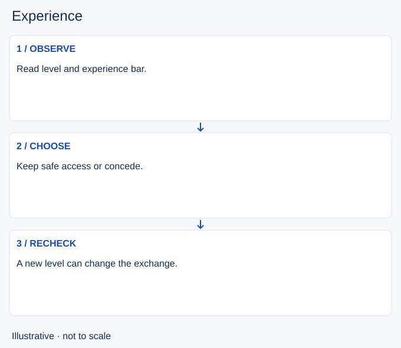

# Experience

- Stable lesson ID: MA38
- Slug: experience
- Category: Macro
- Roles and level: All roles; beginner to intermediate.
- Summary: Separate level progress from last-hit income.
- Prerequisites: Last-hitting, Spacing.
- Observable action: Check your level and progress before approaching a wave.

## Short answer

Experience is the resource that raises your champion’s level during a match. A level can improve stats and let you unlock or strengthen an ability. It is separate from gold and from your account level.

## How it works

Watch your experience bar as well as minion health. Lane minion experience has a proximity rule: missing a last hit does not necessarily mean missing experience. Sharing a lane changes experience received per champion. Do not assume a remembered minion count gives the same level timing after missed waves or shared experience. Compare visible levels before stepping forward, and learn the actual ability you unlock rather than treating every level as the same advantage.

1. Check your level and progress before approaching a wave.
2. Choose a position that preserves access without taking an unaffordable hit.
3. Recheck both champions’ levels before the next exchange.

## Hypothetical example

You cannot safely approach a low-health minion for its last hit. You stay farther back where you can still receive experience, then see your experience bar rise as it dies. On a later wave, the opponent levels before you. You give space rather than contesting as though nothing changed. This assumes the safer position is within experience range; if it is not, concede the experience too.

<!-- Figure: MA38 -->

*Illustrative choices for experience; not measured game timing or positions.*

## Common mistake and correction

**Mistake:** Equating low CS with no experience, or risking death to avoid losing one minion.

**Correction:** Track gold opportunities and level progress separately; survival may require conceding both.

## Practice

In a practice session, watch the experience bar for three minions you last-hit and three nearby minions you do not. Then review two lane level-ups in player view. Record the visible level change, any ability it enabled, and whether your spacing changed before the next trade.

## Limits

Exact ranges, experience shares and level thresholds can change. Champion, role and mode rules can alter gains. This lesson does not prescribe an exact early level-up count.

## Related lessons

[Last-hitting](../micro/MI01-last-hitting.md) · [Spacing](../micro/MI07-spacing.md) · [Resource management](../micro/MI16-resource-management.md)

## Sources and limits

[Riot: How to Play](https://www.leagueoflegends.com/en-us/how-to-play/) explains champion levels and ability growth. [Riot: Patch 25.S1.1](https://www.leagueoflegends.com/en-us/news/game-updates/patch-25-s1-1-notes/) documents minion experience range; [Riot: Patch 26.1](https://www.leagueoflegends.com/en-gb/news/game-updates/patch-26-1-notes/) documents solo/shared experience. Historical values are not reproduced as current rules.

Checked 4 November 2026 (Pacific time). Examples and exercises are editorial teaching proposals, not validated rank-improvement methods.
