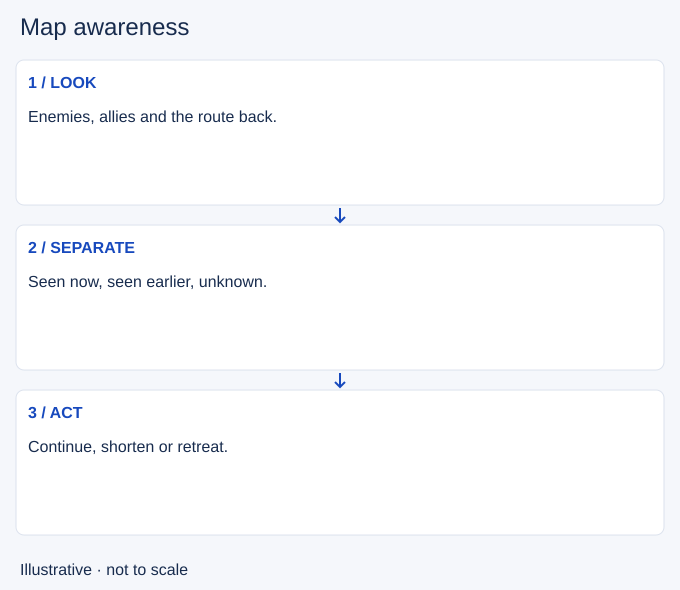

# Map awareness

- Stable lesson ID: MA39
- Slug: map-awareness
- Category: Macro
- Roles and level: All roles; beginner to intermediate.
- Summary: Turn visible map information into a decision before committing.
- Prerequisites: Spacing.
- Observable action: Check the map before a commitment, when immediate movement is safe.

## Short answer

Map awareness means noticing relevant information beyond your immediate target and using it to choose your next action. It combines the minimap, nearby camera view and what remains unknown.

## How it works

Fog of war hides areas outside your team’s vision. A missing enemy is unknown, not absent. Before moving forward or leaving lane, look for visible enemies, nearby allies and the route back. Use a brief camera check when an ally’s icon alone does not show whether they can help. Return attention to your champion before an immediate dodge or attack timing task. The aim is a useful decision, not staring at the minimap for a fixed percentage of play.

1. Check the map before a commitment, when immediate movement is safe.
2. Separate a current sighting from an old sighting or guess.
3. Choose to continue, shorten the action or retreat; signal a relevant threat to allies.

## Hypothetical example

You are about to follow an opponent toward river. The minimap shows your nearby ally returning to base, while another enemy is missing. You stop at the known area and return to the wave. You do not need to prove an ambush exists to decide that the chase lacks support.

<!-- Figure: MA39 -->

*Illustrative choices for map awareness; not measured game timing or positions.*

## Common mistake and correction

**Mistake:** Checking the minimap but continuing the original action unchanged.

**Correction:** Name the decision the new information changes. If it changes nothing, explain why.

## Practice

Pause three replay moments before crossing into a less visible area. Use your team’s view. Write one current sighting, one unknown, an ally who can actually help and your chosen action. Resume and identify the first new cue that should change it. Do not use spectator information to grade the original choice.

## Limits

Icons and sightings cannot reveal intentions or future routes. This drill does not set a universal glance interval. Warding creates information; map awareness is using the information available.

## Related lessons

[Spacing](../micro/MI07-spacing.md) · [Cooldown tracking](../micro/MI15-cooldown-tracking.md)

## Sources and limits

[Riot: How to Play](https://www.leagueoflegends.com/en-us/how-to-play/) describes limited team vision and fog of war. The observation routine is editorial guidance, not a Riot-prescribed scan schedule.

Checked 4 November 2026 (Pacific time). Examples and exercises are editorial teaching proposals, not validated rank-improvement methods.
