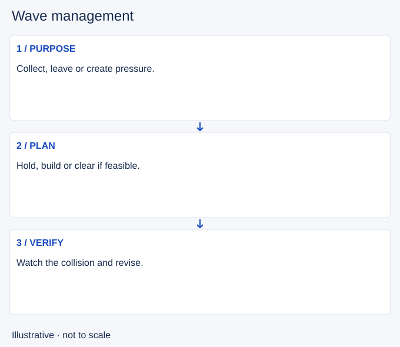

# Wave management

- Stable lesson ID: MA40
- Slug: wave-management
- Category: Macro
- Roles and level: All roles; beginner to intermediate.
- Summary: Choose a wave plan before choosing how quickly to attack.
- Prerequisites: Last-hitting, Experience, Map awareness.
- Observable action: Name the next job: stay and collect, prepare a departure, or create pressure.

## Short answer

Wave management means influencing where lane minions fight and how quickly they advance to support your next action. Last-hitting collects individual minions; wave management considers the whole wave and the next reinforcements.

## How it works

Start with position, surviving minion health, incoming reinforcements and who can safely add damage. These affect the direction and speed of a push. Choose a purpose before adding attacks. A fast push clears quickly; a slow push builds an advancing wave; a freeze tries to keep successive collisions near one place. A crash is the wave reaching the enemy turret, while a bounce is a later reversal in push direction. Those are results to verify, not promises attached to your first attack.

1. Name the next job: stay and collect, prepare a departure, or create pressure.
2. Choose a feasible hold, buildup or clear using the wave and nearby threats.
3. Observe the next collision and revise the plan if it does not produce the intended result.

## Hypothetical example

You want to return to base. If you can safely clear and finish the crash, a fast push may support that departure. If clearing would leave you exposed with no escape, leave with an imperfect wave instead. In a different state, when you are healthy and do not need to leave yet, a slow buildup may be useful. The purpose and constraints determine the choice.

<!-- Figure: MA40 -->

*Illustrative choices for wave management; not measured game timing or positions.*

<!-- Interactive: wave-states -->

## Going deeper

**Use the animation to compare plans.** Each scenario shows a different result from the same lane. Ask which one supports your next job, and what it costs.

**Waves set up everything else.** Recalls, roams, dives and objective fights all depend on where waves are. Strong players plan the wave a minute or two ahead: "I will slow push this wave, crash it, then recall."

**Read the opponent's wave too.** A wave that is about to crash into your turret limits where you can go. Before leaving lane, check what the enemy wave will do while you are gone.

**Cannons and big waves.** Some waves are worth more than others. Crashing a large or valuable wave before a recall costs the opponent more than crashing a small one.

## Common mistake and correction

**Mistake:** Always attacking the wave as fast as possible, or forcing a freeze regardless of the map.

**Correction:** Match the wave plan to a useful next action and abandon it when keeping it costs too much.

## Practice

Pause three lane replays before you add damage. Record wave position, likely direction, your next job and chosen plan. Watch the next collision. Identify the damage or reinforcement that confirmed or changed your prediction. Use the following lessons to practise the specific plan you found hardest.

## Limits

No fixed minion count guarantees a hold or bounce. Champion damage and enemy interference can change the result. This overview introduces the choices; the following lessons explain each technique.

## Related lessons

[Last-hitting](../micro/MI01-last-hitting.md) · [Experience](../macro/MA38-experience.md) · [Map awareness](../macro/MA39-map-awareness.md) · [Fast pushing](../macro/MA13-fast-pushing.md)

## Sources and limits

[Riot: Hwei Abilities Rundown](https://www.leagueoflegends.com/en-us/event/hwei-abilities-rundown/) gives a champion-specific example of clearing to recall or roam and warns about exposure. It supports the purpose-and-risk framing, not a universal wave formula. The broader choice framework synthesizes the existing wave lessons.

Checked 4 November 2026 (Pacific time). Examples and exercises are editorial teaching proposals, not validated rank-improvement methods.
