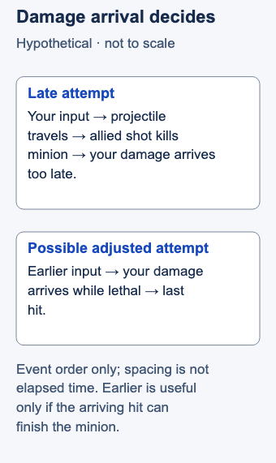

# Last-hitting

## Short answer

Last-hitting means dealing the killing hit to a minion to collect its last-hit reward. Timing, target choice and the risk of approaching all matter.

Time your attack so its damage reaches the minion while that damage can finish it. Watch the falling health bar **and incoming attacks**. A ranged attack can arrive too late if you wait until the minion already looks ready to die. Riot explicitly discusses firing early in its [last-hit indicator explanation](https://www.leagueoflegends.com/en-us/news/game-updates/league-of-legends-patch-26-5-notes/).

## Read the health trend, then attack

A **last hit** is the hit that kills a minion. **Farming** means collecting minions for income; **CS**, or creep score, records minions and monsters killed. A basic attack is your champion's ordinary attack rather than an ability cast. This lesson practices lane minions, with no monster-clear instructions.

Your input and the damage arriving are different moments. For a ranged attack, notice the projectile leaving your champion and reaching its target. Treat the health bar as a changing situation: allied attacks may arrive before yours. The indicator documentation also lists limits on represented damage modifiers, so an assist marker is not a universal instruction to click now. This lesson does not require that feature or claim it is available in your queue. See Riot's [Last Hit Indicators section](https://www.leagueoflegends.com/en-us/news/game-updates/league-of-legends-patch-26-5-notes/).

Use this teaching sequence:

1. **Choose a likely target.** Look for a minion losing health, then notice visible allied attacks travelling toward it.
2. **Estimate the arrival window.** Ask whether your hit would finish it when your damage arrives, rather than at the instant you click.
3. **Commit when the approach is affordable.** If reaching the minion exposes you to an enemy threat, letting it go can be the better choice.
4. **Name the miss before changing your timing.** Did your hit land too early, arrive after the minion died, select the wrong target, or encounter an unexpected incoming hit?

Visible information supports an estimate. You cannot know every future minion target. Changes in your damage, temporary effects or attack rhythm can require a fresh estimate; one successful attempt is not a permanent threshold.

## Hypothetical example

You are farming with an ordinary ranged attack. A low-health caster minion has an allied shot approaching it. You click, but that shot kills the minion before yours arrives.

On the next comparable attempt, begin earlier and watch the arrival. If your damage lands while the minion still survives, you went too early for that situation. Adjust from what actually happened rather than deciding every miss needs an earlier click. These are illustrative attempts, not a recorded match or a champion-specific timing demonstration.

<!-- Figure: MI01; use one width variant at a time. -->

*The click starts the attempt; damage arrival decides the last hit. An earlier input helps only if the arriving damage is enough to finish the minion.*

Figure files: [desktop SVG](../visuals/assets/mi01-desktop.svg) · [mobile SVG](../visuals/assets/mi01-mobile.svg) · [desktop PNG](../visuals/previews/mi01-desktop.png) · [mobile PNG](../visuals/previews/mi01-mobile.png).

## Common mistake → correction

**Mistake:** You count every missed minion as bad timing and walk farther forward to rescue the next one.

**Correction:** Separate timing misses from minions conceded to danger or competing demands. Approaching has a cost. The lesson's action is to time an affordable last hit; it does not require collecting every minion. Spending a spell may be reasonable in play, but it changes this isolated basic-attack exercise.

## Practice: classify the arrival

In a practice session, keep one champion and setup stable. Take three short samples of lane farming using basic attacks. For each attempted last hit, record secured, early arrival, late arrival or other/uncertain. Record deliberately conceded minions separately.

Compare the raw counts and choose one timing adjustment for the next sample. [Mobalytics' Farming and CSing section](https://mobalytics.gg/lol/guides/essential-skills-mid-laners) supports isolated farming practice; this recording method is our teaching proposal. A lower miss count is descriptive feedback, not a validated improvement promise or rank standard.

## Related lessons

[Spacing](../micro/MI07-spacing.md)

## Sources and limits

Reviewed basis: Riot Games, *Patch 26.5*, March 3, 2026, Last Hit Indicators; Mobalytics, *Essential Skills to Master for Mid Laners*, displayed publisher byline Mobalytics, updated October 31, 2025, Farming and CSing. Links above reopened for this draft. Riot supports the arrival principle; the second publisher supports practice. No universal turret recipe, current assist-access claim or exact damage threshold is included. Last editorial check: November 3, 2026 Pacific; independent article review completed on 3 November 2026 Pacific / 4 November UTC.

Editorial revision: concept scope updated for LEA-24 on 3 November 2026 Pacific. Prior review dates above refer to the inherited research package; revised prose received an integration review, not a new independent expert review. Examples and drills remain illustrative.
