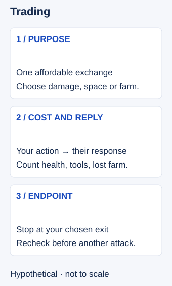

# Trading

## Short answer

Trading is an exchange of attacks or abilities between champions. A useful trade improves your position for the next action without spending more health, resources or farm than you can afford.

When you see an enemy spend the ability that most limits your approach, consider one short response. Check their remaining threats, your own tools and your way out before moving forward. A spent spell can create an opportunity; it does not establish a safe countdown. Both [Dignitas' trading advice](https://dignitas.gg/articles/top-5-tips-diamond-players-use-that-you-dont) and [Mobalytics' Trading section](https://mobalytics.gg/lol/guides/essential-skills-mid-laners) support looking for important cooldown openings.

## Choose the kind of trade

A short trade aims to end after one attack or a small set of spells. An extended trade continues through more attacks and decisions. Poke aims to deal damage from a position that limits a reply; retaliation answers an opponent’s commitment. An all-in commits to trying for a kill and is a different risk from a limited exchange. These describe intentions, not guaranteed outcomes.

Compare health lost and gained, casting resources spent, abilities left, minions missed and the position afterward. Dealing more damage does not make a trade useful if it leaves you unable to farm or escape. Matchups and the current state determine which length is affordable; this article supplies no universal winning sequence.

Two common cues are a spent ability and a last-hit attempt. When a low allied minion gives the opponent a reason to approach, you can consider pressure, but they may abandon it or answer you. Check your own farm and the second opponent in a duo lane. Use spacing to decide whether you can approach and leave safely.

## Turn the cooldown cue into a bounded decision

A **cooldown** is the wait before an ability can be used again. A **trade** is a limited exchange of attacks or abilities. The relevant **window** is the opportunity you assess after a cast, not a timer you can necessarily see. An ability with a **recast** may still have another activation; a reset may restore availability.

Two foundations make the cue useful. **Spacing** means managing distance from an enemy's available reach, including movement abilities, while preserving an exit. **Resources** include health, mana or another casting resource, and abilities you still need after the exchange. Check what would remain if you take the action. The reviewed [retaliation guide](https://mobalytics.gg/lol/guides/how-to-retailiation-trade) supports considering state and resources; it does not supply a universal trade rule.

Use this editorial decision sequence:

1. **Name the limiting tool.** Pick the enemy ability that makes approaching dangerous. A minor cast is not automatically the opening you need.
2. **Observe its use.** “I saw it cast” is evidence. “They have not cast it recently” leaves availability unknown. Account for a remaining recast or reset if relevant; decline when you cannot assess it.
3. **Check the whole exchange.** Look at your health and usable tools, the minion wave, other enemies and any ally you would need. An ally busy farming may not follow. A missing enemy is not known to be far away.
4. **Choose an action and endpoint.** Take one affordable attack or spell, use the space to farm or reposition, or decline. Name where you will stop before advancing. Reassess if the enemy changes the situation.

The procedure is teaching synthesis. It does not reveal hidden skill ranks, cooldown modifiers or unseen opponents. Chasing may spend farm, time and the defensive ability you needed to leave.

## Hypothetical example

The opposing support misses the catch spell that has kept you back. Your lane partner is close enough to act, your own spell is ready, and your retreat route is open. You choose one poke, then return to your earlier position.

Change one condition: your partner is occupied under the turret and cannot help. You let the same cast create breathing room to farm instead. The observed ability use is unchanged; your response changes because support for the exchange is different. No duration or matchup victory is assumed.

<!-- Figure: MI06; use one width variant at a time. -->

*Trading is a complete exchange: include the reply and the position afterward. This is a decision schematic, not a damage calculation.*

## Common mistake → correction

**Mistake:** “Their important spell is down, so I keep chasing.”

**Correction:** The cast justifies assessing an opening. It does not answer whether their other tools win the exchange or whether you can leave. End the action at the position you chose, and abandon it sooner if new threats appear. Taking space or declining can be a complete response.

## Practice: record one response per cast

Choose one important enemy ability in a replay. For its first five visible uses, pause before the outcome. Record **trade, reposition or decline**, plus one visible reason and your stopping point. Resume and note information you missed without rewriting the original decision.

The observable task is five explicit responses grounded in the cast and surrounding state. This is a proposed recognition drill, not a validated training method; winning the trade is not its score.

## Related lessons

[Spacing](../micro/MI07-spacing.md) · [Cooldown tracking](../micro/MI15-cooldown-tracking.md) · [Resource management](../micro/MI16-resource-management.md) · [Poking](../micro/MI18-poking.md)

## Sources and limits

Dignitas / lolmjlauer, June 17, 2021, When to Trade / Knowing Key Cooldowns; Mobalytics, displayed byline Mobalytics, updated October 31, 2025, Trading; Mobalytics, updated October 30, 2025, retaliation guide, body credits PicklePants. Links above reopened for drafting. The opening principle has two coaching publishers; the conservative response sequence is editorial synthesis. No old champion timer, universal engage instruction or omniscient availability claim is imported. Last editorial check: November 3, 2026 Pacific; independent article review completed on 3 November 2026 Pacific / 4 November UTC.

Revision source note: Riot’s [Hwei designer rundown, General Weaknesses](https://www.leagueoflegends.com/en-us/event/hwei-abilities-rundown/) was checked for the principle that spent defensive tools and limited resources can create vulnerability. It is historical design context, not a current matchup prescription. The former last-hit pressure application also draws on Dignitas / Teatones, [Punish Positioning](https://dignitas.gg/articles/how-to-improve-your-skillshots-in-league-of-legends), March 3, 2024, and Dignitas / Papril, [support pressure](https://dignitas.gg/articles/how-to-apply-pressure-as-a-support-during-lane), April 5, 2026; retained from the reviewed package.

Editorial revision: concept scope updated for LEA-24 on 3 November 2026 Pacific. Prior review dates above refer to the inherited research package; revised prose received an integration review, not a new independent expert review. Examples and drills remain illustrative.
