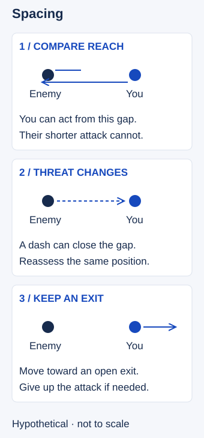

# Spacing

## Short answer

**Spacing** is managing the distance between your champion and other champions so you can act while limiting their available replies. It is an ongoing adjustment as players move and abilities become available. Good spacing balances safety with useful reach; standing too far away can stop you from contributing.

## Compare reach, not just distance

**Attack range** is the distance at which a basic attack can reach a target. For this lesson, **threat reach** means the area an opponent could threaten with their currently available attacks, spells and movement. It is a teaching description, not a single in-game statistic. A dash or a spell can matter even when you stand outside ordinary attack range. Different tools threaten different shapes and directions.

Start with three questions: what can reach me, what can I reach, and where can I move next? If your chosen action reaches farther than the reply you are considering, a useful distance may let you act without entering that reply’s reach. That does not make the position safe from every other spell or enemy. If the opponent has more reach, you may need to stay back, approach only after a relevant tool is spent, or give up the action.

Spacing is different from [Dodging](MI09-dodging.md), which avoids an aimed ability, and [Kiting](MI10-kiting.md), which combines damage with movement. Spacing supplies the distance decisions for both. You can space without attacking at all, for example while waiting for an ally or declining a dangerous minion.

## Adjust as the situation moves

1. **Name the relevant threat.** Identify the enemy tool that limits your next action. Account for other enemies who can reach the same space. If a tool’s availability or reach is unknown, keep a margin instead of assuming an exact safe edge.
2. **Choose a useful position.** Stay close enough for your intended action when the cost is acceptable, with room to leave. Terrain, the wave and allied positions can make equal distances very different choices.
3. **Respond to movement.** When the enemy advances, reconsider your distance before continuing. When they retreat, moving forward may preserve pressure, but following into an unchecked area can give up your exit.
4. **Reassess after a cast.** A spent ability can change the available threat. Other tools, recasts or a second enemy can still prevent an approach. Return to a safer distance when the opening ends or the information becomes unclear.

Do not treat a drawn range edge as a guaranteed safety line. These are moving decisions, not a fixed circle that protects you. Reaction time, uncertainty and unfamiliar abilities justify extra room. Sometimes the useful choice is to stop dealing damage and leave.

## Hypothetical example

You are a ranged champion facing an opponent who, in this simplified example, has only a shorter-range attack available. You stay within your own reach while outside that attack’s reach. When the opponent walks toward you, you step back to preserve the gap; when they move away, you may follow only as far as your exit remains open.

Now change one condition: the opponent has an available gap-closing ability, or a second enemy approaches from the side. The old distance no longer answers the threat. You widen the gap or retreat toward help, even if that means losing a chance to attack. No champion range, guaranteed free hit or actual match outcome is asserted.

<!-- Figure: MI07; use one width variant at a time. -->

*Spacing changes with available threats. The schematic distances are illustrative, not champion ranges; the second case invalidates the first case’s assumption.*

## A last-hit opportunity is only one application

A dying allied minion can give the opponent a reason to step forward. You may use that movement to choose a trade, but the opponent can abandon the minion or answer with another tool. Spacing is the distance assessment before, during and after that attempt. The pressure decision belongs in [Trading](MI06-trading.md); recognizing the minion’s health belongs in [Last-hitting](MI01-last-hitting.md).

## Common mistake and correction

**Mistake:** “I am outside their basic attack range, so I am safe.” You hold position while a different ability or another enemy can reach you.

**Correction:** Name the actual threat to your intended action and keep an exit. Check it again when either player moves. Also avoid the opposite mistake: retreating so far that you cannot help an ally when a useful, affordable position is available.

## Practice: explain the distance

Pause a replay at five moments before an exchange. Mark your intended action, the nearest relevant enemy threat and an exit. Write whether you would hold, advance or retreat, and why. Resume from player view and note what movement or cast should change that answer. If you cannot identify a tool’s reach, record that gap for practice instead of filling in a precise number.

This is an editorial drill, not a validated performance test. Review the reason and the information available, not only whether you avoided damage.

## Related lessons

[Experience](../macro/MA38-experience.md)

## Sources and limits

Primary-source check: Riot Games / Myles “Riot Emizery” Salholm, [Hwei Abilities Rundown](https://www.leagueoflegends.com/en-us/event/hwei-abilities-rundown/), General Weaknesses, Team Fighting and Late Game; opened for this revision on 3 November 2026 Pacific. The designer describes vulnerability after defensive tools are spent and the balance between maintaining distance and being too far away to support a team. This is historical design context, not certification of Hwei’s current numbers or a current matchup guide.

The distance comparison, hypothetical opponent and four-step process are editorial teaching synthesis. No exact ranges, cooldowns, hitbox rules or guaranteed safe margin are supplied. Previous MI07 research concerned last-hit pressure: Dignitas / Teatones, March 3, 2024, Punish Positioning; Dignitas / Papril, April 5, 2026, support pressure; Mobalytics / PicklePants, retaliation conditions, updated October 30, 2025. That research is retained with Trading and in the prior reviewed package; it is not passed off as a complete source for spacing. This rewrite has an integration review, not a new independent expert review.
