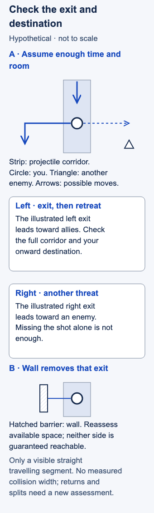

# Dodging

## Short answer

Dodging means moving to avoid an aimed ability. It includes positioning before a cast and movement after one starts. This introduction develops the straight-projectile case; cones, ground areas and returning spells need their own path checks.

For a visible projectile travelling along a straight segment, move out to a reachable side when you have enough room and time. Choose the side that leaves a safer next position. [Dignitas' linear-skillshot guide](https://dignitas.gg/articles/skills-versus-shots-a-guide-on-how-to-dodge-the-different-types-of-skillshots-in-league-of) supports stepping off the path rather than retreating along it. That principle does not make every incoming spell reactively avoidable.

## Check the path and the destination

A **skillshot** is an aimed ability whose path or area can miss you. A **projectile** travels through space. This lesson concerns a visible, straight travelling segment. Imagine its **corridor** as the strip it threatens, allowing for the space your champion occupies; the drawn center line alone is not the whole danger.

**Collision** means what the spell can hit or pass through. A nearby minion is useful cover only if that particular spell is blocked by it. **Spacing** means keeping distance from available threats while retaining somewhere to move. You need an exit before the projectile arrives, not merely empty ground elsewhere on the screen.

Our teaching sequence is:

1. **Recognize the segment.** Notice where the visible projectile is travelling. If you cannot identify the path in time, do not assume a reaction was available.
2. **Choose a reachable side exit.** Compare nearby terrain, enemy positions and your onward route. A wall can remove an apparent exit; an enemy can make the other side dangerous.
3. **Move outside the corridor.** If retreat would keep you on the shot's line, consider the side route that actually leaves it. Avoid treating a tiny sideways click as proof you cleared the threatened strip.
4. **Reassess the next position.** Continue toward safety when possible. Handle any return, split or follow-up as a new threat rather than assuming the first dodge solved it.

[Dignitas' dodging theory](https://dignitas.gg/articles/blogs/League-of-Legends/4567/skillshot-dodging-general-theory-and-specific-tips) discusses positional consequences, while its [dodge-options analysis](https://dignitas.gg/articles/improving-the-effectiveness-of-your-skillshots) illustrates constrained routes. The corridor explanation is geometric reasoning and the sequence is editorial synthesis, not measured dodge-success evidence.

## Hypothetical example

A visible spear-like projectile travels down an open lane toward you. Assume you have enough time and movement space to leave its corridor. One side leads toward allies; the other leads toward an enemy who can threaten you. You step toward the ally side, clear the path and continue along your retreat route.

Now put a wall beside that exit. The same click may no longer work. You must assess the remaining space rather than repeat the earlier direction. If neither side is reachable before contact, record that limit; this example supplies no guaranteed escape or champion-specific spell rule.

<!-- Figure: MI09; use one width variant at a time. -->

*Leaving the projectile path is only part of the choice. Check the destination and whether an exit is reachable in time.*

Figure files: [desktop SVG](../visuals/assets/mi09-desktop.svg) · [mobile SVG](../visuals/assets/mi09-mobile.svg) · [desktop PNG](../visuals/previews/mi09-desktop.png) · [mobile PNG](../visuals/previews/mi09-mobile.png).

## Common mistake → correction

**Mistake:** You avoid the projectile but finish beside another enemy, then call the dodge successful because the first spell missed.

**Correction:** Check where the movement leaves you. Avoiding one hit can still worsen your position. Conversely, being hit does not alone establish bad execution: a close cast, wide path or blocked exit may leave no reactive walking option. Earlier positioning and mobility decisions are separate questions.

## Practice: mark the exit or its absence

In a replay, choose ten visible straight projectiles aimed near you. Pause before contact. For each, mark a reachable side exit and its next position, or write **no clear exit / uncertain** with a reason. Resume and compare your chosen route with what happened.

The observable action is to identify a viable destination, including acknowledging its absence. This proposed drill has no validated pass threshold. Do not count an impossible reaction as a timing mistake or turn ten clips into a claim about your overall dodge rate.

## Related lessons

[Spacing](../micro/MI07-spacing.md) · [Skillshots](../micro/MI14-skillshots.md) · [Kiting](../micro/MI10-kiting.md)

## Sources and limits

Linked sources: Dignitas / Lucklepto, September 3, 2021, Dodging Linear Skillshots; Dignitas / k0nduit, October 29, 2018, projectile movement and positional discussion; Dignitas / Luigimash, July 5, 2021, Understanding Dodge Options. All reopened for this draft; all share one educational publisher. No experimental corroboration or probability is claimed. Targeted, tracking and circular spells, full return/split behavior, and universal beam reactions are outside scope. No exact hitbox widths or current map measurements are supplied. Last editorial check: November 3, 2026 Pacific; independent article review completed on 3 November 2026 Pacific / 4 November UTC.

Editorial revision: concept scope updated for LEA-24 on 3 November 2026 Pacific. Prior review dates above refer to the inherited research package; revised prose received an integration review, not a new independent expert review. Examples and drills remain illustrative.
