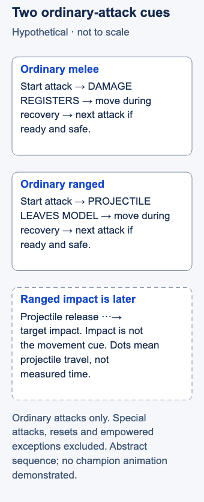

# Kiting

## Short answer

Kiting combines damage with movement to manage distance from a target, often while retreating from a pursuer. Spacing decides where you want to be; attack timing determines when you can take the next step. This introduction uses ordinary basic attacks.

For an **ordinary melee attack**, move after its damage registers. For an **ordinary ranged attack**, move after the projectile leaves your champion's model. Use the following recovery for a useful step, then attack again when ready if it remains safe. These distinct cues come from [Dignitas' ordinary-attack discussion](https://dignitas.gg/articles/the-fundamentals-of-auto-attacking-like-a-pro-in-league-of-legends). Special attacks, resets and empowered exceptions are outside this lesson.

## Learn one ordinary attack rhythm

A basic or **auto attack** is your champion's attack rather than a spell cast. Its **windup** is the part before the damage event or projectile release. **Recovery** is the following part before another attack is ready. Moving too early can cancel an intended ordinary attack. **Kiting** combines attacks with movement to manage distance.

Do not use the same visual event for both attack types. A melee learner checks that damage registered; a ranged learner checks that the projectile left the model. Damage reaching the ranged target is a later event. The source also explains that attack speed changes the rhythm. Its timing discussion is single-source coaching, not validation of every champion's animations. See [What Makes Pros Good](https://dignitas.gg/articles/the-fundamentals-of-auto-attacking-like-a-pro-in-league-of-legends).

<!-- Figure: MI10; use one width variant at a time. -->

*Use registered damage for ordinary melee attacks and projectile release for ordinary ranged attacks. Movement still needs a useful destination.*

Figure files: [desktop SVG](../visuals/assets/mi10-desktop.svg) · [mobile SVG](../visuals/assets/mi10-mobile.svg) · [desktop PNG](../visuals/previews/mi10-desktop.png) · [mobile PNG](../visuals/previews/mi10-mobile.png).

Apply this proposed learning sequence:

1. **Choose one ordinary attack and stable setup.** Use a practice target. Avoid empowered states, attack resets and unusual attack patterns so the exercise has one clear question.
2. **Observe before adding movement.** Make stationary attacks and identify the relevant cue. If it is unclear, retain that uncertainty rather than inventing an exact frame or delay.
3. **Add one short, purposeful move.** After the cue, step toward a chosen position, then issue the next attack when ready. Keep the target in reach for this isolated exercise.
4. **Reassess before repeating.** A useful destination preserves distance from an available enemy threat and leaves an exit. If another attack would cost too much escape time, keep moving. Relearn the rhythm when attack speed changes.

The actionable goal is one useful movement between preserved ordinary attacks. Clicking more often is not itself the goal. This lesson does not promise correct targeting from a particular control setting or teach pulling jungle monsters; camp boundaries and resets need separate instruction.

## Hypothetical example

A ranged carry has room to attack a pursuer and retreat toward allies. The carry lets the ordinary projectile leave the model, takes a short step toward those allies and considers the next attack. As the pursuer gains ground, the carry stops attacking and retreats continuously. The value of another hit no longer justifies the pause.

For a separate ordinary melee practice attempt, the movement cue would be registered damage, not a projectile. Neither illustration specifies a champion or demonstrates an exact animation. A precise champion cue demonstration requires validation before it is added.

## Common mistake → correction

**Mistake:** You copy a fast attack–move rhythm without checking whether your intended attacks completed.

**Correction:** Slow the exercise down. Watch the correct cue for your attack type, then verify the result. Also inspect the destination: movement that carries you toward an available threat can be poor even when the attack completes. When retreat is urgent, omitting the attack may be the better action. [Mobalytics' retreat discussion](https://mobalytics.gg/lol/guides/how-to-retailiation-trade) supports that safety limit, not the precise release cue.

## Practice: preserve an attack while adding a step

Use the same ordinary attack, target, items and attack speed for paired stationary and moving samples of equal duration. Exclude approach time. Record intended attacks that visibly fail to complete, completed attacks and whether each step had a chosen destination. Repeat after one deliberate adjustment.

Compare your own samples without a percentage pass mark. If the cue remains ambiguous, mark it uncertain for review. This is a teaching proposal, not a validated performance test, and dummy results do not establish combat safety.

## Related lessons

[Last-hitting](../micro/MI01-last-hitting.md) · [Spacing](../micro/MI07-spacing.md) · [Map awareness](../macro/MA39-map-awareness.md)

## Sources and limits

Dignitas / lolmjlauer, March 29, 2022, *The Fundamentals of Auto Attacking Like a Pro*, What Makes Pros Good; Mobalytics, updated October 30, 2025, retaliation guide, retreat section, body credit PicklePants. Links above reopened for drafting. The exact ordinary-attack cue remains supported by one educational source. No client experiment, champion cue demo, exact timing, special/empowered attack rule or Target Champions Only interaction is asserted. Last editorial check: November 3, 2026 Pacific; independent article review completed on 3 November 2026 Pacific / 4 November UTC.

Editorial revision: concept scope updated for LEA-24 on 3 November 2026 Pacific. Prior review dates above refer to the inherited research package; revised prose received an integration review, not a new independent expert review. Examples and drills remain illustrative.
