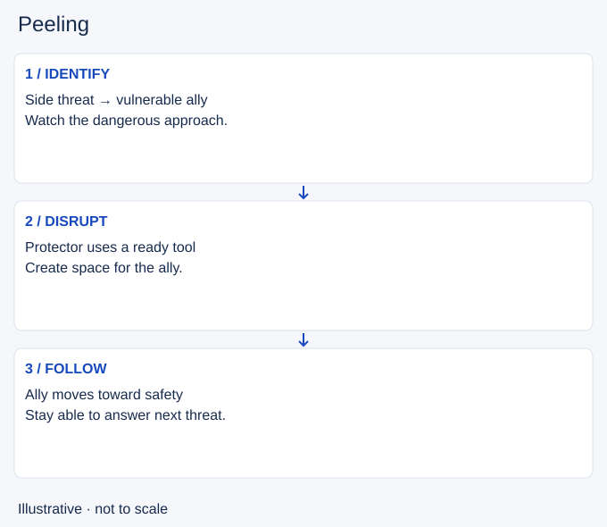

# Peeling

- Stable lesson ID: MI11
- Slug: peeling
- Category: Micro
- Roles and level: All roles; beginner to intermediate.
- Summary: Protect an ally by disrupting the threat that can reach them.
- Prerequisites: Crowd control, Positioning.
- Observable action: Name the ally you need to protect and the enemy approach that threatens them. Check whether your relevant tool is ready.

## Short answer

Peeling means preventing an enemy from reaching or continuing to attack a vulnerable ally. You can use suitable crowd control, positioning or protective tools to give that ally room to move and act.

## How it works

Identify the threat to the ally before choosing your target. The closest enemy to you may not be the one about to reach them. Stay close enough to help without placing both of you in the same danger. Save a suitable response for the approach you expect, then reassess after it is used. The goal is useful space for the ally, not necessarily a kill on the attacker.

1. Name the ally you need to protect and the enemy approach that threatens them. Check whether your relevant tool is ready.
2. Position so the tool can reach the threat or ally. Avoid chasing so far forward that you cannot respond.
3. Use the tool when it can change the approach, then move with the ally’s exit. Look for the next threat instead of assuming the fight is solved.

## Hypothetical example

An enemy frontline champion is within your attack range, but a second opponent approaches your damage dealer from the side. You stop following the frontline and keep your control ability available for the side approach. Once you disrupt that attacker, you retreat with your ally instead of chasing the attacker away from them.

<!-- Figure: MI11 -->

*Illustrative decision sequence for peeling; positions and timing are not game measurements.*

## Common mistake and correction

**Mistake:** Using every control ability to start a fight, then having no response when an enemy reaches the ally behind you.

**Correction:** Before committing, decide whether your current job is to start the fight or protect someone. Change that job when the visible threats change.

## Practice

In three team-fight replays, pause just before an enemy reaches an ally. Identify the threat, your relevant tool and your distance from the ally. Watch whether your previous action left you able to help. Write one earlier position or ability choice that would preserve that option.

## Limits

Peeling does not guarantee survival. Some attacks cannot be stopped by the tool you have, and multiple threats can exceed your resources. Check the specific ability interaction in game; this lesson does not assert that every dash or cast can be interrupted.

## Related lessons

[Crowd control](../micro/MI21-crowd-control.md) · [Positioning](../micro/MI12-positioning.md) · [Engaging](../micro/MI13-engaging.md)

## Sources and limits

[Source and context](https://www.leagueoflegends.com/en-us/news/game-updates/patch-11-15-notes/). Riot’s patch 11.15 Thresh commentary (21 July 2021) explicitly describes peeling enemies away from vulnerable allies. It supports the concept, not current ability numbers. The threat assessment, hypothetical example and drill are editorial synthesis.

Sources checked 4 November 2026. Examples and exercises are teaching proposals, not tested performance guarantees. No live patch certification or independent expert review is claimed.
