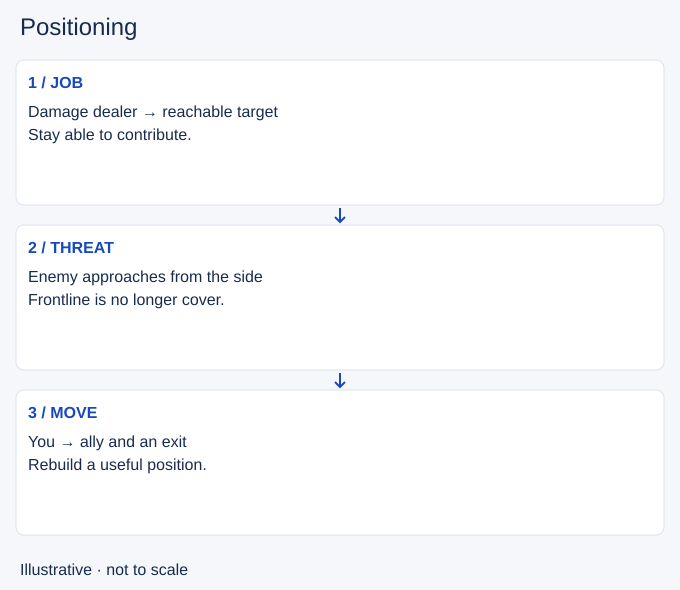

# Positioning

- Stable lesson ID: MI12
- Slug: positioning
- Category: Micro
- Roles and level: All roles; beginner to intermediate.
- Summary: Choose a place where you can do your job and respond to danger.
- Prerequisites: Spacing, Map awareness.
- Observable action: Name your current job and the enemy most able to stop it.

## Short answer

Positioning means choosing where to stand and move relative to allies, enemies and terrain. In a fight, a useful position lets you contribute while keeping a response to the threats that matter.

## How it works

Your role changes the useful position. A damage dealer needs access to a safe target; a protector needs access to an ally. Distance from one opponent is only part of the picture. Spacing handles that local range relationship; positioning includes the whole fight.

1. Name your current job and the enemy most able to stop it.
2. Choose a reachable target or ally and an exit.
3. Move again when a threat appears or an important ability is used.

## Hypothetical example

You stand behind your frontline, but an enemy approaches from a side entrance. The frontline no longer separates you from that threat. You move toward a teammate who can help and attack the reachable target instead of crossing the fight to reach a preferred one.

<!-- Figure: MI12 -->

*Illustrative decision sequence for positioning; positions and timing are not game measurements.*

## Common mistake and correction

**Mistake:** Treating “behind the tank” as safe in every situation.

**Correction:** Check side approaches and the path you would take if forced back.

## Practice

Pause three fights just before you take damage. Mark your job, the dangerous approach and an exit. Rewind one action. Identify a position that would preserve your contribution and a response.

## Limits

No spot removes all risk. Very safe positions can also put you too far away to help. This lesson does not prescribe champion-specific ranges.

## Related lessons

[Spacing](../micro/MI07-spacing.md) · [Map awareness](../macro/MA39-map-awareness.md) · [Target selection](../micro/MI22-target-selection.md)

## Sources and limits

[Source and context](https://dignitas.gg/articles/positioning-kiting-and-tanking-how-to-win-every-teamfight). Ahrivve’s original guide supports role-based positioning and staying able to contribute. Old champion and item examples are not carried over.

Sources checked 4 November 2026. Examples and exercises are teaching proposals, not tested performance guarantees. No live patch certification or independent expert review is claimed.
