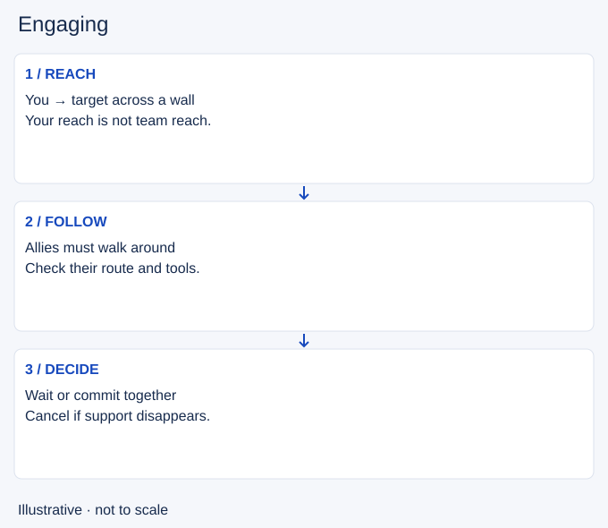

# Engaging

- Stable lesson ID: MI13
- Slug: engaging
- Category: Micro
- Roles and level: All roles; beginner to intermediate.
- Summary: Start a fight when allies can follow and the target is worth the commitment.
- Prerequisites: Crowd control, Target selection.
- Observable action: Name the intended target and what winning this fight would enable.

## Short answer

Engaging means initiating a fight or forcing an opponent to respond to a committed threat. A successful opening needs more than contact: your team must be able to use it.

## How it works

Compare your reach with the path your allies must travel. A target in your range may still be outside their useful range. Consider health, available abilities and the purpose of fighting before you go.

1. Name the intended target and what winning this fight would enable.
2. Check that allies can follow without crossing an unmanageable threat.
3. Signal the attempt, then cancel if the opening or support disappears.

## Hypothetical example

You can dash onto an enemy near a wall, but your damage dealer must walk around it. You wait rather than treating the dash as permission. When the enemy steps toward your team, you recheck the opening from the new positions.

<!-- Figure: MI13 -->

*Illustrative decision sequence for engaging; positions and timing are not game measurements.*

## Common mistake and correction

**Mistake:** Judging an engage only by whether your first ability lands.

**Correction:** Review whether teammates could contribute during the opening.

## Practice

For three attempted engages, pause before the first committed movement. Trace each nearby ally’s path to the target. Write “follow-up available”, “delayed” or “unclear”, then compare with what happened.

## Limits

Teammates may choose not to follow. A ping is a signal, not a guarantee. Sometimes protecting an ally is more valuable than starting a fight.

## Related lessons

[Crowd control](../micro/MI21-crowd-control.md) · [Target selection](../micro/MI22-target-selection.md) · [Disengaging](../micro/MI23-disengaging.md)

## Sources and limits

[Source and context](https://dignitas.gg/articles/a-comprehensive-support-guide-with-dignitas-biofrost). The Biofrost interview supports engage and protection as different team responsibilities. The follow-up audit is an original teaching exercise.

Sources checked 4 November 2026. Examples and exercises are teaching proposals, not tested performance guarantees. No live patch certification or independent expert review is claimed.
