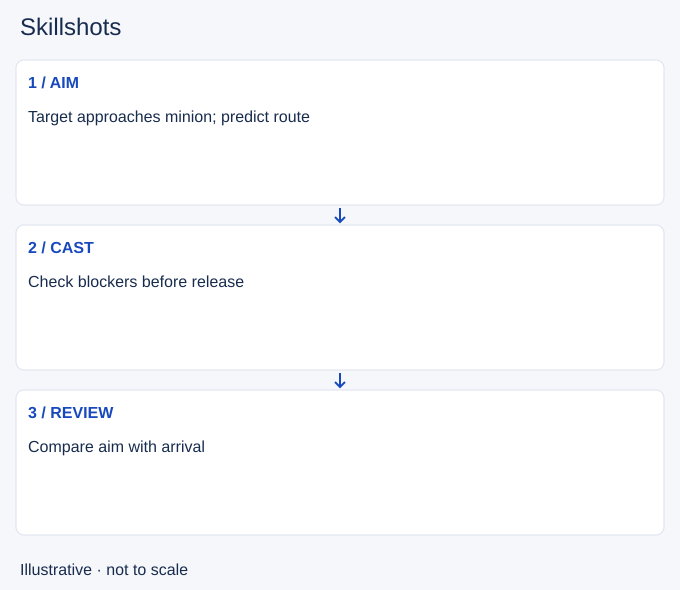

# Skillshots

- Stable lesson ID: MI14
- Slug: skillshots
- Category: Micro
- Roles and level: All roles; beginner to intermediate.
- Summary: Aim at a plausible movement path, then check what made the shot land or miss.
- Prerequisites: Spacing, Resource management.
- Observable action: Check the spell's shape and blockers.

## Short answer

Skillshots are aimed abilities whose success depends on where and when you cast, rather than simply selecting a target. Their shapes, travel and collision rules differ.

## How it works

Watch the target's available movement before aiming. A narrow route can reduce their choices; open ground gives them more exits. Check whether this particular spell passes through units. A blocked shot is a different error from aiming behind a moving target.

1. Check the spell's shape and blockers.
2. Watch the target's next likely movement.
3. Cast only when the hit is worth the spent ability.

## Hypothetical example

An opponent walks toward a minion to attack it. You aim along that approach, but they turn away. You keep your distance while the spell recovers instead of following to force a second attempt.

<!-- Figure: MI14 -->

*Illustrative decision sequence for skillshots; arrows show decisions, not measured game positions or timing.*

## Common mistake and correction

**Mistake:** Aiming at the current position every time.

**Correction:** Compare cast position with the target's position when the spell arrives.

## Practice

Review five casts. Label each miss as aim, timing, blocker or target movement. Choose the most common cause and repeat five attempts with that single correction.

## Limits

Prediction is uncertain. Some spells have different collision rules or can change direction; read the current ability description.

## Related lessons

[Spacing](../micro/MI07-spacing.md) · [Resource management](../micro/MI16-resource-management.md) · [Dodging](../micro/MI09-dodging.md)

## Sources and limits

[Riot: Champion Counterplay](https://www.leagueoflegends.com/en-us/news/dev/quick-gameplay-thoughts-may-14/). Primary design context for tactical responses and champion strengths and weaknesses. It is not a current ability reference.

Checked 4 November 2026. The explanations, hypothetical scenarios, diagrams and exercises are editorial teaching guidance. Source context is not proof that a drill improves rank. No patch-specific numbers or independent expert review are claimed.
