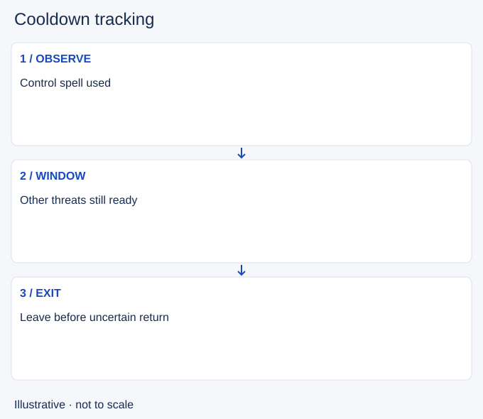

# Cooldown tracking

- Stable lesson ID: MI15
- Slug: cooldown-tracking
- Category: Micro
- Roles and level: All roles; beginner to intermediate.
- Summary: Use observed casts to estimate which threats are temporarily unavailable.
- Prerequisites: Skillshots, Resource management.
- Observable action: Name the important ability you saw used.

## Short answer

Cooldown tracking means keeping track of when an ability has been used and when it may return. It helps you judge a threat window without treating a guess as a visible timer.

## How it works

Separate your own displayed cooldowns from enemy estimates. An observed cast is evidence; an unseen cast is not. Rank, haste and reset effects can change return times. Use a conservative window when the exact timing is unknown, and watch for other tools that still threaten you.

1. Name the important ability you saw used.
2. Check the remaining enemy tools and nearby allies.
3. End the advance before your estimate becomes unsafe.

## Hypothetical example

The enemy misses a control spell. You take a short trade while it is unavailable, then retreat. Their damage spell remains ready, so you do not treat the missed control spell as permission for an all-in.

<!-- Figure: MI15 -->

*Illustrative decision sequence for cooldown tracking; arrows show decisions, not measured game positions or timing.*

## Common mistake and correction

**Mistake:** Counting a remembered base cooldown as exact.

**Correction:** Use a cautious estimate and update it when you learn more.

## Practice

Review three trades after a visible enemy cast. Record the evidence, the tool still available and when you stopped. Check whether you stayed after the original opening ended.

## Limits

Resets and champion-specific rules can invalidate a count. This lesson gives no patch-specific timer.

## Related lessons

[Skillshots](../micro/MI14-skillshots.md) · [Resource management](../micro/MI16-resource-management.md) · [Crowd control](../micro/MI21-crowd-control.md)

## Sources and limits

[Riot: Champion Counterplay](https://www.leagueoflegends.com/en-us/news/dev/quick-gameplay-thoughts-may-14/). Primary design context for tactical responses and champion strengths and weaknesses. It is not a current ability reference.

Checked 4 November 2026. The explanations, hypothetical scenarios, diagrams and exercises are editorial teaching guidance. Source context is not proof that a drill improves rank. No patch-specific numbers or independent expert review are claimed.
