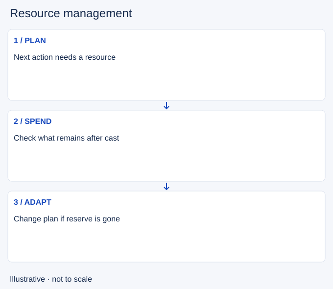

# Resource management

- Stable lesson ID: MI16
- Slug: resource-management
- Category: Micro
- Roles and level: All roles; beginner to intermediate.
- Summary: Spend health and ability resources with the next action in mind.
- Prerequisites: Last-hitting.
- Observable action: Name your next likely action.

## Short answer

Resource management is choosing how to spend and preserve health, mana, energy or other champion resources. The cost of an action includes what you will be unable to do afterward.

## How it works

Read your champion's actual resource bar and costs. Before using an ability for farm or poke, consider whether the remaining resources support an escape, another wave or a fight. Health also changes which spaces you can safely occupy. An unused resource has no value if saving it costs a more important opportunity.

1. Name your next likely action.
2. Check its resource requirement in game.
3. Choose the current cast with that reserve in mind.

## Hypothetical example

You could use a spell to secure a difficult minion, but doing so would leave too little mana for your escape. With the enemy jungler unaccounted for, you let the minion go and keep the escape option.

<!-- Figure: MI16 -->

*Illustrative decision sequence for resource management; arrows show decisions, not measured game positions or timing.*

## Common mistake and correction

**Mistake:** Saving every spell until you lose useful farm or pressure.

**Correction:** Reserve for a specific purpose instead of refusing all spending.

## Practice

Review one lane sequence. At three casts, pause and record the resource remaining and your next intended action. Identify one cast that helped that plan and one that prevented it.

## Limits

Some champions do not use mana, and resource recovery differs. Use the current champion's rules rather than a universal reserve percentage.

## Related lessons

[Last-hitting](../micro/MI01-last-hitting.md) · [Skillshots](../micro/MI14-skillshots.md)

## Sources and limits

[Riot: Champion Counterplay](https://www.leagueoflegends.com/en-us/news/dev/quick-gameplay-thoughts-may-14/). Primary design context for tactical responses and champion strengths and weaknesses. It is not a current ability reference.

Checked 4 November 2026. The explanations, hypothetical scenarios, diagrams and exercises are editorial teaching guidance. Source context is not proof that a drill improves rank. No patch-specific numbers or independent expert review are claimed.
