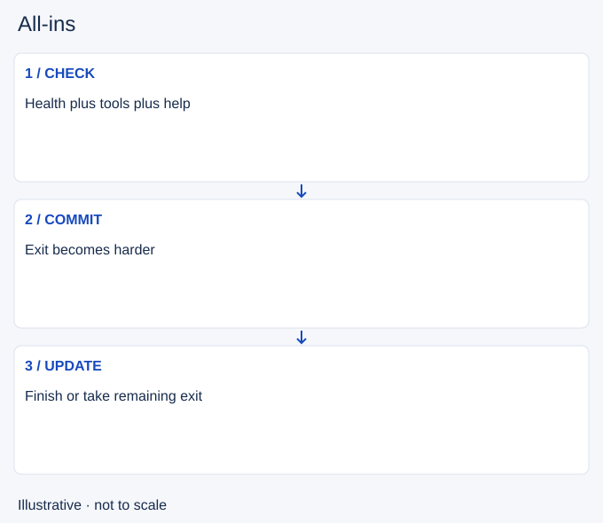

# All-ins

- Stable lesson ID: MI17
- Slug: all-ins
- Category: Micro
- Roles and level: All roles; beginner to intermediate.
- Summary: Recognise when a short exchange becomes a committed fight.
- Prerequisites: Trading, Crowd control, Summoner spells.
- Observable action: Check what can stop your damage.

## Short answer

An all-in is a committed attempt to finish a fight, usually spending major tools and accepting that a quick exit may no longer be available. It differs from a trade you intend to end after a small exchange.

## How it works

Compare health, levels, available abilities, escape routes and possible reinforcements. Decide whether you can keep dealing damage long enough to finish. The opponent may survive the first burst or retreat toward help. A low health bar alone is not enough evidence.

1. Check what can stop your damage.
2. Identify enemy escape tools and incoming help.
3. Commit only with a credible finish or exit plan.

## Hypothetical example

An enemy is low, but your main ability is still unavailable and their ally is moving up. You stop after a short trade. Later, with your tools ready and the ally elsewhere, you reassess instead of assuming the first chance still exists.

<!-- Figure: MI17 -->

*Illustrative decision sequence for all-ins; arrows show decisions, not measured game positions or timing.*

## Common mistake and correction

**Mistake:** Confusing low enemy health with a guaranteed kill.

**Correction:** Compare usable tools and positions as well as health.

## Practice

Review three committed fights. Mark the last moment you could stop cheaply, the information available then and the tool you needed to finish. Judge that decision before checking the result.

## Limits

Matchups and mechanics can change the outcome. This is a commitment check, not a damage calculator.

## Related lessons

[Trading](../micro/MI06-trading.md) · [Crowd control](../micro/MI21-crowd-control.md) · [Summoner spells](../micro/MI26-summoner-spells.md) · [Zoning](../micro/MI19-zoning.md)

## Sources and limits

[Riot: Champion Counterplay](https://www.leagueoflegends.com/en-us/news/dev/quick-gameplay-thoughts-may-14/). Primary design context for tactical responses and champion strengths and weaknesses. It is not a current ability reference.

Checked 4 November 2026. The explanations, hypothetical scenarios, diagrams and exercises are editorial teaching guidance. Source context is not proof that a drill improves rank. No patch-specific numbers or independent expert review are claimed.
