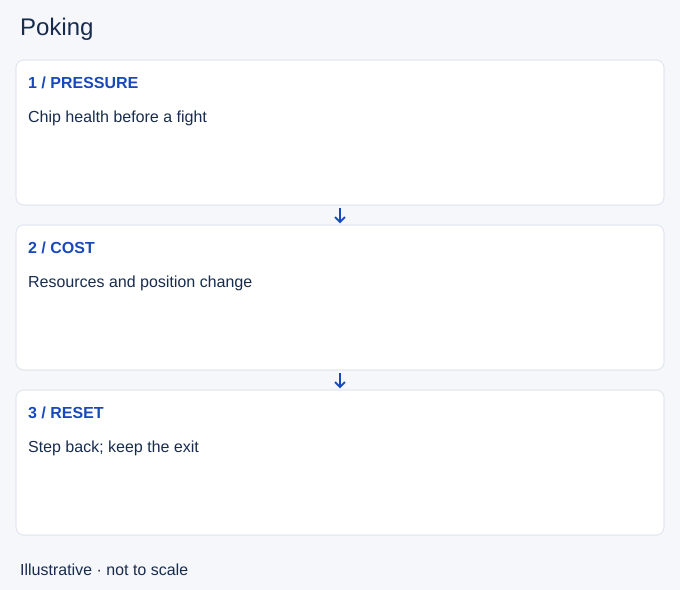

# Poking

- Stable lesson ID: MI18
- Slug: poking
- Category: Micro
- Roles and level: All roles; beginner to intermediate.
- Summary: Deal damage at low commitment while preserving a safe position.
- Prerequisites: Trading, Skillshots.
- Observable action: Choose the target whose lost health matters.

## Short answer

Poking means using repeated attacks or abilities to reduce enemy health before a full fight. The purpose is to change their next decision, such as forcing them away from an entrance or making a contest harder.

## How it works

Compare the health pressure you create with the resources and safety you spend. A hit can be unhelpful if it costs your only escape or prevents the next wave clear. Move after casting so the opponent cannot answer along the same predictable line.

1. Choose the target whose lost health matters.
2. Keep an exit while using the poke tool.
3. Recheck resources and enemy engagement range.

## Hypothetical example

Before a river contest, you land a ranged spell on the enemy frontline. Your team is still arriving, so you step back instead of chasing for another hit. The damage can help later without starting a fight now.

<!-- Figure: MI18 -->

*Illustrative decision sequence for poking; arrows show decisions, not measured game positions or timing.*

## Common mistake and correction

**Mistake:** Walking into engagement range to land one more spell.

**Correction:** Keep the low-commitment purpose of poke in mind.

## Practice

Review five poke attempts. Record damage dealt, resources spent and whether you stayed safe. Pick one cast that was technically accurate but strategically costly, and explain why.

## Limits

Enemy sustain can reduce the value of poke. Do not assume chip damage creates a lasting advantage.

## Related lessons

[Trading](../micro/MI06-trading.md) · [Skillshots](../micro/MI14-skillshots.md) · [All-ins](../micro/MI17-all-ins.md)

## Sources and limits

[soduh / Dignitas: Poke Compositions](https://dignitas.gg/articles/team-composition-guide-to-poke-compositions-in-league-of-legends). Original coaching context distinguishing poke from siege and explaining disengage (2021). Historical builds, champion numbers and matchup prescriptions are excluded.

Checked 4 November 2026. The explanations, hypothetical scenarios, diagrams and exercises are editorial teaching guidance. Source context is not proof that a drill improves rank. No patch-specific numbers or independent expert review are claimed.
