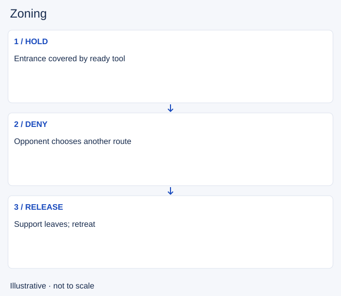

# Zoning

- Stable lesson ID: MI19
- Slug: zoning
- Category: Micro
- Roles and level: All roles; beginner to intermediate.
- Summary: Use a credible threat to restrict where an opponent can stand.
- Prerequisites: Spacing, Trading.
- Observable action: Name the space you want to deny.

## Short answer

Zoning means making an area costly for an enemy to enter through position, abilities or the threat of an attack. It can protect an ally, deny access to a wave or delay an approach without dealing damage.

## How it works

A zone depends on a threat you can actually use. If your main ability is down or enemies can overwhelm you, standing forward may offer no control. Check the ally or resource you are protecting, then hold a position from which you can respond and leave.

1. Name the space you want to deny.
2. Check whether your threat is credible.
3. Release the space when the threat or support disappears.

## Hypothetical example

Your team is taking an objective. You hold a nearby entrance with a control spell ready. When a second enemy appears and your allies cannot help, you back toward them instead of defending the entrance alone.

<!-- Figure: MI19 -->

*Illustrative decision sequence for zoning; arrows show decisions, not measured game positions or timing.*

## Common mistake and correction

**Mistake:** Thinking an aggressive position automatically controls space.

**Correction:** Tie the position to a ready tool and reachable support.

## Practice

Watch three moments when an opponent changes route near you. Identify the likely threat and what would remove it. Then review one failed attempt to zone and name the missing condition.

## Limits

Some opponents can ignore or cross your threat. Zoning is conditional pressure, not an invisible wall.

## Related lessons

[Spacing](../micro/MI07-spacing.md) · [Trading](../micro/MI06-trading.md) · [Baiting](../micro/MI24-baiting.md)

## Sources and limits

[Riot: Champion Counterplay](https://www.leagueoflegends.com/en-us/news/dev/quick-gameplay-thoughts-may-14/). Primary design context for tactical responses and champion strengths and weaknesses. It is not a current ability reference.

Checked 4 November 2026. The explanations, hypothetical scenarios, diagrams and exercises are editorial teaching guidance. Source context is not proof that a drill improves rank. No patch-specific numbers or independent expert review are claimed.
