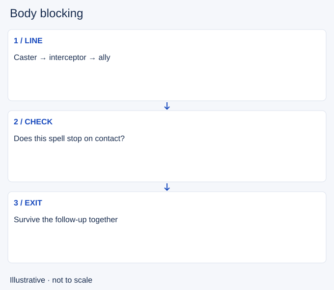

# Body blocking

- Stable lesson ID: MI20
- Slug: body-blocking
- Category: Micro
- Roles and level: All roles; beginner to intermediate.
- Summary: Intercept a blockable threat only when the exchange helps your team.
- Prerequisites: Skillshots, Positioning.
- Observable action: Check that the threat can hit an intervening unit.

## Short answer

Body blocking means placing your champion between a threat and its intended target to intercept it. This lesson concerns attacks or projectiles that can be blocked by another unit, not a promise to obstruct every movement or spell.

## How it works

Confirm the ability's collision rule first. Consider whether the intercepted hit also stops you, damages nearby allies or exposes you to a follow-up. Protecting an ally can be worthwhile, but moving into every projectile may create a worse target for the enemy.

1. Check that the threat can hit an intervening unit.
2. Compare your survival with the ally's risk.
3. Move onto the line while preserving a useful escape.

## Hypothetical example

A vulnerable teammate retreats from a single-target projectile that stops at the first champion. You step into its line with enough health to survive, then both retreat. You do not stack beside the ally against an area attack.

<!-- Figure: MI20 -->

*Illustrative decision sequence for body blocking; arrows show decisions, not measured game positions or timing.*

## Common mistake and correction

**Mistake:** Trying to block a spell that passes through you.

**Correction:** Verify the specific spell interaction before relying on it.

## Practice

In a replay, find three incoming projectiles. Draw the caster-to-target line and identify collision behavior from the ability description. State whether interception would help and what you would risk.

## Limits

Piercing, area and targeted effects behave differently. Current ability text and controlled practice must confirm the interaction.

## Related lessons

[Skillshots](../micro/MI14-skillshots.md) · [Positioning](../micro/MI12-positioning.md) · [Peeling](../micro/MI11-peeling.md)

## Sources and limits

[Riot: Champion Counterplay](https://www.leagueoflegends.com/en-us/news/dev/quick-gameplay-thoughts-may-14/). Primary design context for tactical responses and champion strengths and weaknesses. It is not a current ability reference.

Checked 4 November 2026. The explanations, hypothetical scenarios, diagrams and exercises are editorial teaching guidance. Source context is not proof that a drill improves rank. No patch-specific numbers or independent expert review are claimed.
